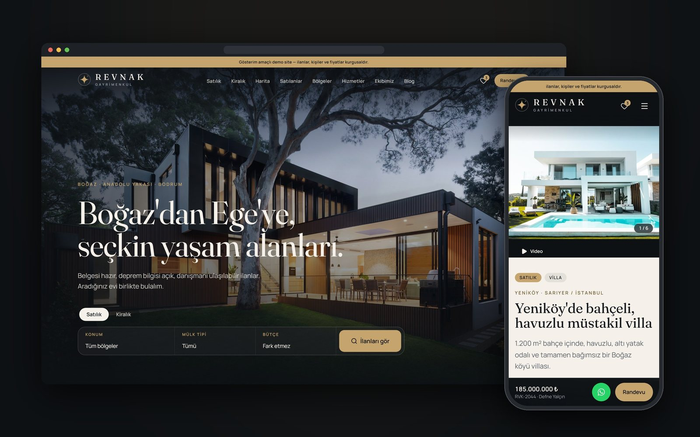
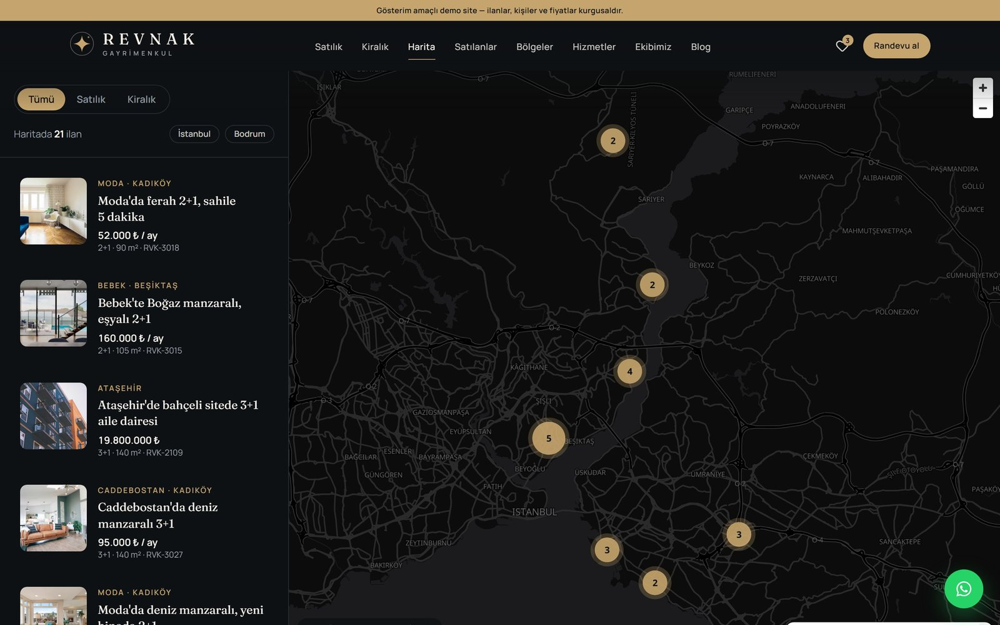
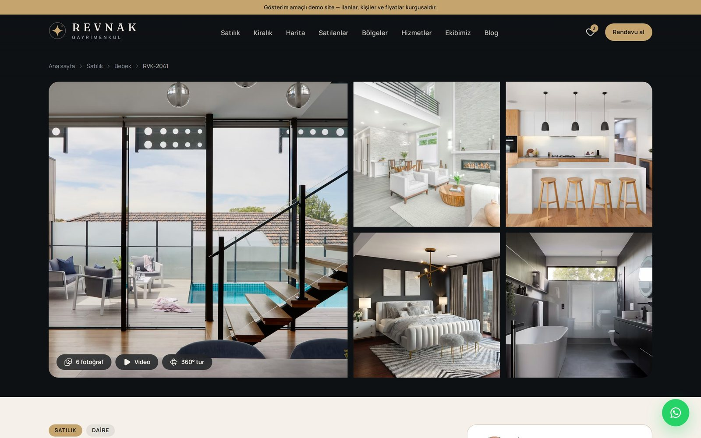
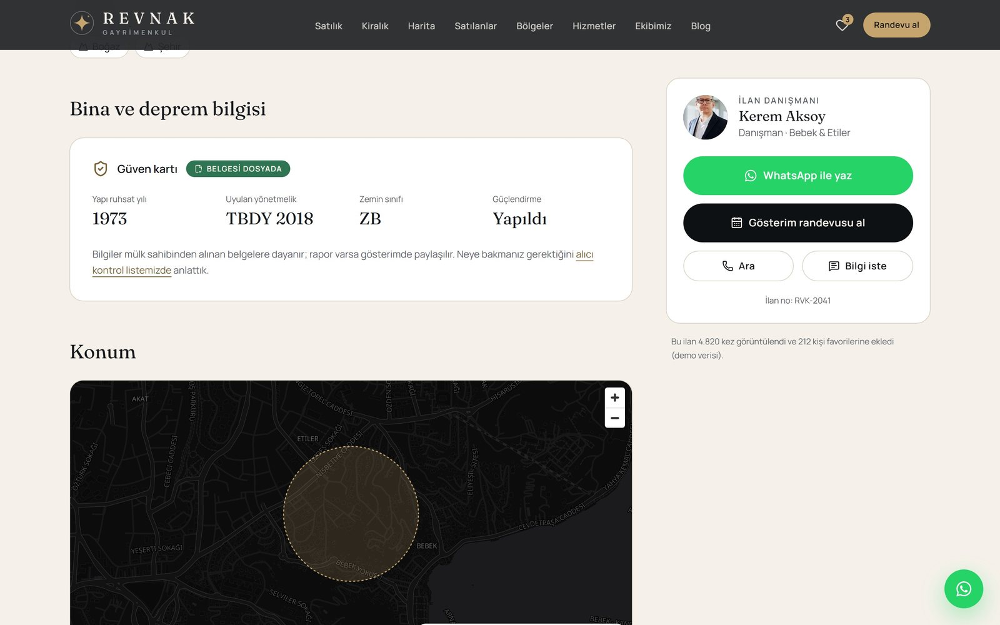
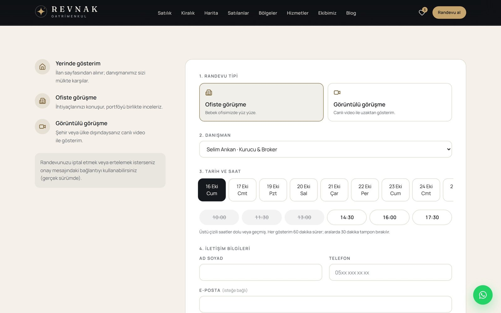
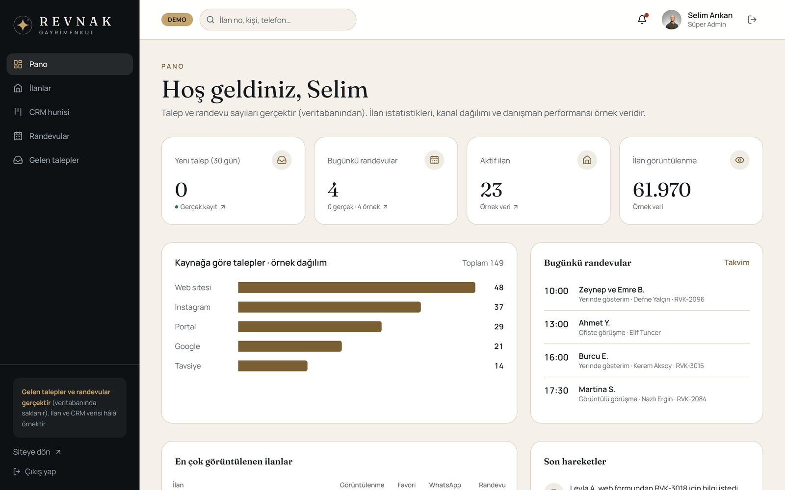
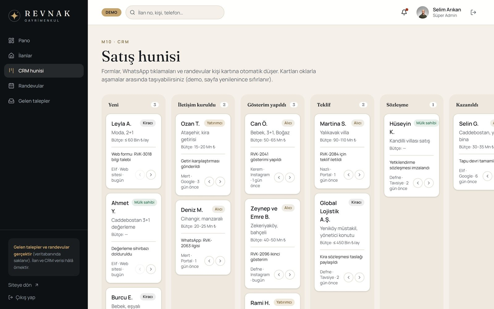
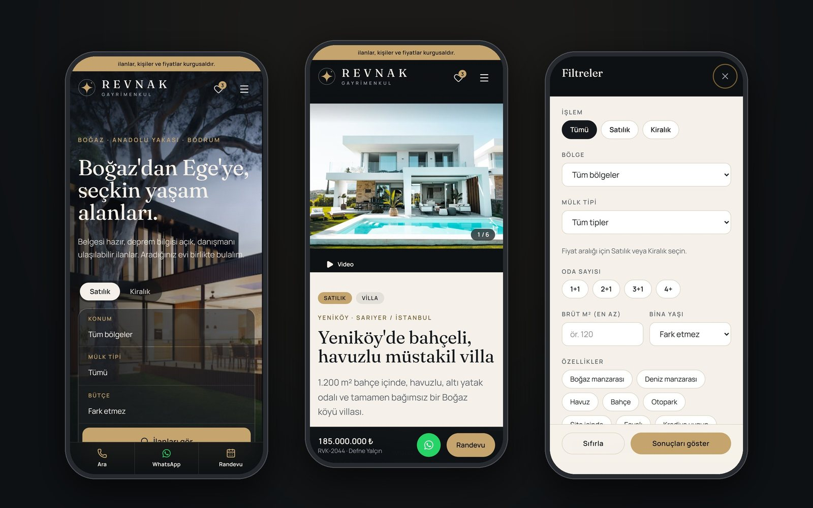
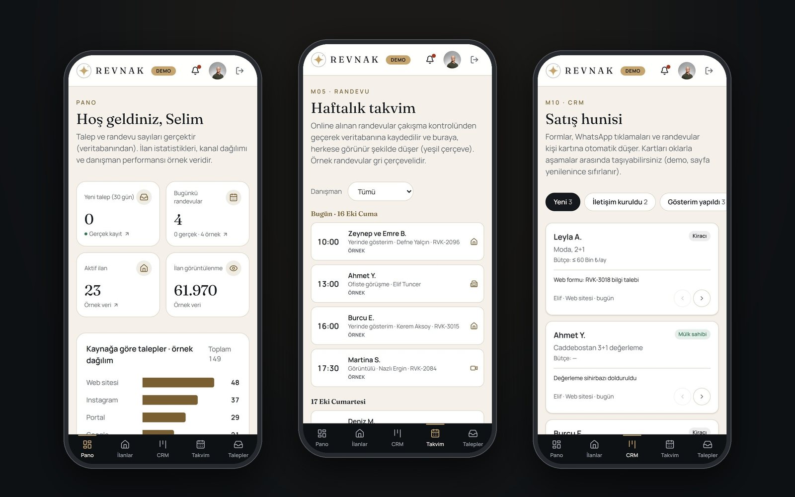

# Revnak Gayrimenkul

İstanbul (Boğaz hattı, Anadolu yakası) ve Bodrum'da konut satan ve kiralayan bir emlak ofisi için uçtan uca web platformu:
ziyaretçiye ev aramayı kolaylaştıran bir site ve talepleri, randevuları, satış sürecini yöneten parola korumalı bir ofis paneli.

**Canlı demo:** https://revnak-gayrimenkul.vercel.app

> Gösterim amaçlıdır. Firma, ilanlar, kişiler, yorumlar ve fiyatlar kurgusaldır.

*A full-stack real-estate platform built with Next.js 16, React 19, TypeScript, Tailwind CSS 4 and Postgres (Neon + Drizzle):
listing search with map clustering, mortgage calculators, conflict-checked online booking and a password-protected office panel with CRM pipeline and calendar. UI copy is in Turkish.*



## Ekran görüntüleri

| | |
|---|---|
|  |  |
| **Harita ile arama:** kümelenen ilanlar, liste haritada görünen alana göre süzülür | **İlan detayı:** mozaik galeri, video ve 360° tur |
|  |  |
| **Güven kartı:** ruhsat yılı, deprem yönetmeliği, zemin sınıfı, güçlendirme | **Online randevu:** danışmanın boş saatleri, dolu saatler kapalı |
|  |  |
| **Ofis paneli:** gerçek talepler ve günün randevuları | **CRM hunisi:** "Yeni"den "Kazanıldı"ya altı aşama |
|  |  |
| **Mobil site:** sabit fiyat çubuğu, tam ekran filtreler | **Mobil panel:** alt sekme çubuğu, gün gün ajanda |

## Neler var?

**Site**
- **Ana sayfa:** sinematik hero ve hızlı arama, öne çıkan ilanlar, bölge mozaiği, kaydırdıkça ilerleyen "nasıl çalışıyoruz" anlatımı, referanslar, değerleme bandı, ekip ve blog.
- **İlanlar:** adres çubuğunda saklanan (paylaşılabilir) filtreler, sıralama, ızgara/liste görünümü, mobilde tam ekran filtre paneli.
- **İlan detayı:** galeri ve ışık kutusu, m² fiyatının bölge ortalamasıyla kıyası, bina ve deprem güven kartı, yaklaşık konum haritası, kredi hesabı, sabit danışman kartı (WhatsApp, arama, randevu), benzer ilanlar.
- **Harita ile ara:** MapLibre + OpenFreeMap, kümeleme, liste ↔ harita vurgulama.
- **Araçlar:** konut kredisi, tapu masrafı ve kira getirisi hesaplayıcıları; 5 adımlı ev değerleme sihirbazı; 4 ilana kadar karşılaştırma; favoriler.
- **İçerik:** bölge rehberleri, danışman profilleri, blog, satılanlar, SSS, kurumsal ve yasal sayfalar.

**Gerçek altyapı**
- İletişim, ilan bilgi, portföy ve değerleme formları ile randevular **Postgres'e kaydedilir** (Neon + Drizzle), takip numarası döner.
- Randevu çakışması sunucuda veritabanına karşı kontrol edilir; formdaki dolu saatler `/api/randevu/dolu` uç noktasından gelir. Takvime eklenebilir `.ics` dosyası.
- `/panel` parola korumalı: bcrypt ile doğrulanan parola, imzalı JWT oturum çerezi (httpOnly), `src/proxy.ts` ile koruma.
- Zod ile hem tarayıcıda hem sunucuda doğrulama, honeypot spam koruması, KVKK ve İYS onayları, çerez tercihleri.

**Ofis paneli** (`/panel`)
- Pano, ilan yönetimi, 6 aşamalı CRM hunisi, haftalık randevu takvimi, gelen talepler.
- Talepler ve randevular gerçek (veritabanı); ilan istatistikleri ve CRM kişileri örnek veridir, ekranda "Gerçek" / "Örnek" olarak ayrılır.

**Teknik**
- Next.js 16 **Cache Components** ve Partial Prerendering: sayfaların statik kabuğu önceden üretilir, veritabanına bağlı bölümler `<Suspense>` ile akışla gelir.
- SEO: meta etiketleri, dinamik OG görseli, JSON-LD (FAQPage, Article, BreadcrumbList, Offer…), site haritası. Demo olduğu için site `noindex`.
- Erişilebilirlik: klavye ile kullanım, ekran okuyucu etiketleri, "hareketi azalt" tercihine uyum. Animasyonlar yalnızca `transform` / `opacity`.
- Tüm site ve panel 360 px genişliğe kadar mobil uyumlu.

## Teknoloji

Next.js 16 (App Router) · React 19 · TypeScript (strict) · Tailwind CSS 4 · PostgreSQL (Neon) · Drizzle ORM · Zod 4 ·
jose (JWT) · bcryptjs · MapLibre GL · Motion · Lenis · Vitest · Docker · Vercel

## Kurulum

Gereksinim: Node.js 20.9+ (önerilen 24).

```bash
npm install
cp .env.example .env.local      # değerleri doldurun (aşağıda)
npx drizzle-kit push            # tabloları oluşturur
npm run dev                     # http://localhost:3000
```

| Ortam değişkeni | Açıklama |
|---|---|
| `DATABASE_URL` | Neon Postgres bağlantı adresi (Vercel → Storage → Neon otomatik ekler) |
| `SESSION_SECRET` | Panel oturum çerezini imzalar; en az 32 karakter (`openssl rand -base64 32`) |
| `PANEL_PASSWORD_HASH_B64` | Panel parolasının bcrypt hash'i, Base64 ile: `npm run panel:parola -- "parolaniz"` |

Veritabanı değişkenleri olmadan da site açılır; yalnızca formlar ve panel çalışmaz.

> Hash neden Base64? bcrypt hash'i `$2b$10$…` biçimindedir. Next.js `.env.local` dosyasındaki `$AD` ifadelerini
> değişken sanıp genişletir ve hash'i sessizce bozar; Vercel'de ise bu genişletme hiç yapılmaz. Base64 iki ortamda da aynı çalışır.

| Komut | Açıklama |
|---|---|
| `npm run dev` | Geliştirme sunucusu |
| `npm run build` / `npm start` | Production derlemesi ve sunucusu |
| `npm run check` | Lint + tip kontrolü + birim testleri |
| `npm run panel:parola -- "…"` | `PANEL_PASSWORD_HASH_B64` değeri üretir |
| `npm run deploy` | Vercel'e production yayını (Vercel CLI) |

## Docker (opsiyonel)

```bash
docker compose up -d --build   # http://localhost:3050 — Docker Desktop'ta "gayrimenkul-site"
docker compose down
```

Konteyner ortam değişkenlerini `.env.local` dosyasından okur.

## Klasör yapısı

```
src/
  app/(site)/              herkese açık sayfalar
  app/panel/giris/         panel girişi (sunucu eylemi)
  app/panel/(dashboard)/   ofis paneli sayfaları
  app/api/randevu/dolu/    danışmanın dolu randevu saatleri
  app/actions.ts           form ve randevu sunucu eylemleri
  proxy.ts                 /panel erişim denetimi (Next 16'da middleware → proxy)
  db/                      Drizzle şeması, bağlantı ve sorgular
  components/              ui, motion, listings, forms, map, panel…
  data/                    kurgusal vitrin verisi (ilanlar, bölgeler, danışmanlar, blog, CRM)
  lib/data.ts              veri erişim katmanı: sayfalar veriye yalnızca buradan ulaşır
tests/                     Vitest birim testleri
```

Proje planı ve tüm kararlar: [`proje_plani.md`](./proje_plani.md) (demo kapsamı Bölüm 20, karar günlüğü Bölüm 16).
İlerleme günlüğü: [`docs/ilerleme.md`](./docs/ilerleme.md).

## Firma bilgilerini değiştirmek

Ad, iletişim, adres, mesai saatleri, yetki belgesi no: `src/lib/site-config.ts`.
Telefon ve WhatsApp butonları gerçek ofis hattını açar; e-posta örnek adres olduğu için demo penceresi gösterir.
`demo: false` yapıldığında arama motoru engeli kalkar ve demo şeridi kaybolur.

## Kaynaklar

Fotoğraflar [Unsplash](https://unsplash.com) lisansıyla kullanılmıştır. Harita: [OpenFreeMap](https://openfreemap.org) / © OpenStreetMap katkıda bulunanlar.
Yazı tipleri: Fraunces ve Manrope (SIL Open Font License).
