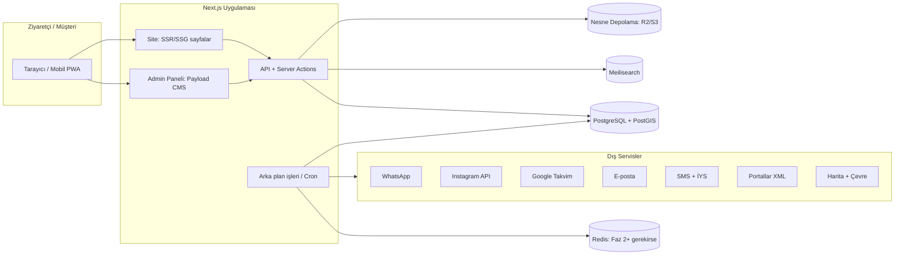
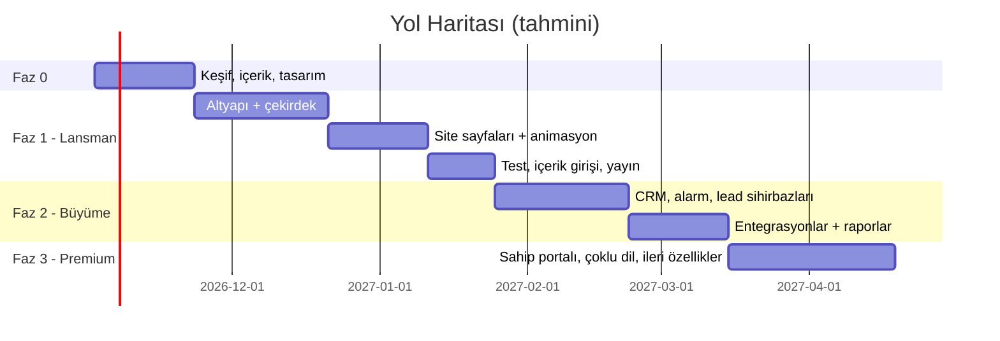

# Proje Planı — Revnak Gayrimenkul Web Platformu

| Alan | Bilgi |
|---|---|
| Doküman sürümü | v0.4 (marka: Revnak, gerçek iletişim bilgileri, Vercel'de canlı) |
| Tarih | 16 Ekim 2026 |
| Durum | **Demo (vitrin) sürümü geliştiriliyor** (Bölüm 20); kalan sorular Bölüm 15'te |
| Yayın | **Vercel** (gösterim amaçlı demo, `*.vercel.app`) |
| Geliştirme modeli | Firma sahibi + yapay zekâ destekli geliştirme (bkz. Bölüm 18–19) |
| Hedef | Şık, modern, efektli; hem müşteri getiren hem ofisi yöneten bir platform |

> Bu doküman projenin "anayasası"dır. Her karar **Bölüm 16 – Karar Günlüğü**'ne işlenir; geliştirme sırasında bu dosyaya aykırı bir şey yapılacaksa önce dosya güncellenir.

> **Güncel durum (v0.3):** Proje şu an **tamamen gösterim (demo) amaçlı** geliştiriliyor ve Vercel'de yayınlanacak (K9). Demo kapsamı, sadeleştirilmiş mimari, iş paketleri ve yayın adımları **Bölüm 20**'dedir. Bölüm 3–19 gerçek (üretim) sürümün hedef mimarisini anlatır ve demodan üretime geçişte referans olarak korunur.

---

## İçindekiler
1. Proje Özeti ve Hedefler
2. Kullanıcı Tipleri ve Roller
3. Mimari ve Teknoloji Yığını
4. Tasarım Sistemi ve Animasyon Dili
5. Site Haritası (Herkese Açık Sayfalar)
6. Ana Sayfa Kurgusu (Sahne Sahne)
7. Modüller (M01–M25)
8. Veri Modeli
9. Yetki Matrisi
10. Fazlar ve Yol Haritası
11. Geliştirme Standartları
12. İçerik Standartları
13. Güvenlik, KVKK ve Yasal Uyum
14. Ortamlar, Yayına Alma ve Bakım
15. Açık Sorular
16. Karar Günlüğü
17. Riskler ve Önlemler
18. Yapay Zekâ Destekli Geliştirme Rehberi
19. Faz 1 İş Paketleri (adım adım)
20. **Demo (Vitrin) Sürümü — güncel çalışma kapsamı**

---

## 1. Proje Özeti ve Hedefler

### 1.1 Vizyon
Bölgenin en güvenilir ve en modern gayrimenkul markası olarak algılanmak: ziyaretçi sitede **ilanı bulur, güvenir, iletişime geçer, randevu alır**; ofis ise tüm bu süreci **tek panelden** yönetir.

### 1.2 İş hedefleri ve ölçütler (KPI)
| Hedef | Ölçüt | İlk 6 ay hedefi |
|---|---|---|
| Müşteri adayı (lead) üretmek | Form + WhatsApp + telefon tıklaması / ay | Faz 1 sonrası ölçülüp baz alınır, sonra +%20/çeyrek |
| Randevu almak | Online alınan gösterim randevusu / ay | Toplam randevuların %30'u online |
| Portföy kazanmak | "Evimi değerle" + "Portföy ver" formları / ay | Ayda 10+ mülk sahibi başvurusu |
| Organik görünürlük | Google'dan gelen ziyaret | Bölge + "satılık daire" aramalarında ilk sayfa |
| Hız ve kalite | Lighthouse (mobil) | Performans ≥ 90, Erişilebilirlik ≥ 95, SEO = 100 |
| Ofis verimliliği | Bir ilanın girilip tüm kanallarda yayına alınma süresi | < 10 dakika |

### 1.3 Kapsam dışı (şimdilik)
- Online ödeme / kapora alma ve günlük-kısa dönem kiralık rezervasyonu (K6: rezervasyon = sadece gösterim/görüşme randevusu)
- Mobil uygulama (site PWA olarak "ana ekrana eklenebilir" olacak; native uygulama sonraki yıl)

---

## 2. Kullanıcı Tipleri ve Roller

| Rol | Kim | Ne yapar |
|---|---|---|
| **Ziyaretçi** | Giriş yapmamış herkes | İlan arar, inceler, WhatsApp/telefon/form ile iletişim kurar, randevu alır |
| **Üye Müşteri** | Kayıt olan alıcı/kiracı | Favoriler, kayıtlı arama, ilan alarmı, karşılaştırma, randevu geçmişi |
| **Mülk Sahibi** | Portföyü bize veren kişi | (Faz 3) Kendi ilanının istatistiklerini ve raporlarını görür |
| **Danışman** | Ofis çalışanı | Kendi ilanlarını, müşterilerini, randevularını yönetir |
| **İçerik Editörü** | Blog/sosyal medya sorumlusu | Blog, bölge rehberleri, sayfalar, SSS |
| **Ofis Yöneticisi** | Broker/şube müdürü | Tüm ilanlar, tüm CRM, raporlar, komisyonlar |
| **Süper Admin** | Firma sahibi + teknik sorumlu | Her şey + site ayarları, kullanıcı/rol yönetimi, entegrasyon anahtarları |

---

## 3. Mimari ve Teknoloji Yığını

### 3.1 Genel mimari



### 3.2 Teknoloji kararları

> Sürüm notu: Geliştirme başlarken her paketin **o günkü en güncel kararlı (LTS) sürümü** seçilip `package.json`'da sabitlenir.
>
> Demo notu: Aşağıdaki tablo **üretim** hedefidir. Demo sürümünde kullanılan sadeleştirilmiş yığın Bölüm 20.2'dedir (Payload, Neon, R2, Meilisearch ve dış API'ler demoda yoktur).

| Katman | Seçim | Neden | Alternatif |
|---|---|---|---|
| Dil | **TypeScript (strict)** | Hata yakalama, ekipte okunabilirlik | – |
| Site çatısı | **Next.js (App Router)** | SEO için sunucu tarafı render, görsel optimizasyonu, hız | Nuxt (Vue) |
| Admin + İçerik yönetimi | **Payload CMS** (Next.js içinde çalışır) | Hazır admin paneli, kullanıcı girişi, rol/yetki, sürüm geçmişi, taslak/yayın, medya yönetimi; özel ekranlar eklenebilir. Admin panelini sıfırdan yazmaktan aylar kazandırır | Laravel + Filament (PHP ekibi varsa), Strapi |
| Veritabanı | **PostgreSQL + PostGIS** | İlişkisel veri + harita sorguları ("bu alan içindeki ilanlar") | MySQL |
| Arama | Faz 1: PostgreSQL tam metin · Faz 2: **Meilisearch** | Yazarken anlık sonuç, yazım hatası toleransı, filtre sayıları, konuma göre arama | Typesense |
| Stil | **Tailwind CSS** + tasarım token'ları | Hızlı, tutarlı, küçük CSS | – |
| Bileşenler | **shadcn/ui** (Radix temelli) | Erişilebilir, tamamen özelleştirilebilir | – |
| Animasyon | **Motion** (eski adıyla Framer Motion) + **GSAP / ScrollTrigger** + **Lenis** | Motion: bileşen içi geçişler · GSAP: kaydırmaya bağlı sahneler · Lenis: yumuşak kaydırma | – |
| İkon/mikro animasyon | Lucide ikonlar + **Lottie** | Hafif, vektörel | – |
| Harita | **MapLibre GL** + vektör karo servisi (MapTiler vb.) | Google'dan ucuz, tamamen özelleştirilebilir (marka renklerinde harita) | Google Maps |
| Çevre bilgisi | Google Places API veya OpenStreetMap (Overpass) | Okul/hastane/market/durak mesafeleri; ilan kaydedilirken bir kez hesaplanıp saklanır (maliyet düşük) | – |
| Medya | **Cloudflare R2** (S3 uyumlu) + `sharp` | Otomatik WebP/AVIF, boyutlandırma, filigran, EXIF/GPS silme | AWS S3 |
| Video | Bunny Stream / Cloudflare Stream veya YouTube (liste dışı) | Uyarlanabilir akış, siteyi yavaşlatmaz | – |
| 360° tur | Matterport/Kuula gömme veya **Pannellum** (açık kaynak) | Kendi çektiğimiz 360 fotoğrafları da gösterebilmek | – |
| Formlar | React Hook Form + **Zod** | Hem tarayıcıda hem sunucuda aynı doğrulama | – |
| E-posta | Resend veya Amazon SES + **React Email** şablonları | Markalı, tutarlı e-postalar | – |
| SMS | Türk SMS sağlayıcısı (Netgsm, İleti Merkezi vb.) | **İYS** entegrasyonu zorunlu | – |
| WhatsApp | Faz 1: tıkla-sohbet bağlantısı · Faz 2: **WhatsApp Business Platform (Cloud API)** | Otomatik randevu hatırlatma, ilan alarmı şablon mesajları | – |
| Instagram | Meta'nın resmi Instagram API'si (İşletme/İçerik Üreticisi hesabı şart) | Gönderiler/Reels belirli aralıklarla çekilip veritabanında önbelleklenir | – |
| Takvim | Google Calendar API | Danışman takvimi ile çift yönlü eşleme | Outlook |
| Arka plan işleri | **Payload Jobs** (veritabanı tabanlı kuyruk) + zamanlanmış görevler (Vercel Cron) | Instagram eşleme, portal XML, bildirimler, raporlar. Ek sunucu (Redis) gerektirmez, tek kişilik geliştirmede yönetim yükü azalır | BullMQ + Redis (yük artarsa) |
| Çoklu dil | next-intl (Faz 3) | URL bazlı dil (`/en/...`) | – |
| Analitik | GA4 + Meta Pixel + Microsoft Clarity (ısı haritası), **izin moduyla** | Hangi kanal müşteri getiriyor, kullanıcı nerede takılıyor | Plausible |
| Hata izleme | Sentry | Canlıda hatayı müşteri fark etmeden görmek | – |
| Test | Vitest (birim) · Playwright (uçtan uca) · Lighthouse CI | Bkz. Bölüm 11 | – |
| Kod deposu & CI | GitHub + GitHub Actions | Her değişiklikte otomatik test + önizleme | GitLab |
| Barındırma | **Vercel** (Frankfurt bölgesi) + **Neon PostgreSQL** (Frankfurt, PostGIS destekli) + **Cloudflare R2** (AB) | Sunucu yönetimi yok, otomatik ölçeklenme, her değişiklikte önizleme bağlantısı; tek kişi + yapay zekâ ile geliştirmede en az operasyon yükü. Veri AB'de kalır (bkz. K7 ve 14.1) | Türkiye'de VPS + Coolify (Docker) |

### 3.3 Klasör yapısı (öneri)

```
/
├── src/
│   ├── app/
│   │   ├── (site)/                # herkese açık sayfalar
│   │   │   ├── ilanlar/ ilan/[slug]/ harita/ satilanlar/
│   │   │   ├── bolgeler/[slug]/ blog/[slug]/ ekibimiz/
│   │   │   ├── randevu/ evimi-degerle/ hesaplayicilar/
│   │   │   └── hesabim/            # üye müşteri paneli
│   │   ├── (payload)/admin/        # admin paneli
│   │   └── api/                    # webhook'lar, dış entegrasyonlar
│   ├── collections/                # Payload koleksiyonları (veri modeli)
│   ├── globals/                    # site ayarları, menü, footer
│   ├── admin-views/                # özel admin ekranları (CRM panosu, takvim, raporlar)
│   ├── components/
│   │   ├── ui/                     # shadcn tabanlı temel bileşenler
│   │   ├── motion/                 # animasyon bileşenleri (Reveal, Parallax, Counter...)
│   │   └── sections/               # ana sayfa ve sayfa bölümleri
│   ├── lib/                        # yardımcılar, entegrasyon istemcileri
│   ├── jobs/                       # arka plan işleri
│   ├── emails/                     # React Email şablonları
│   └── styles/tokens.css           # tasarım token'ları
├── tests/ (unit, e2e)
├── docs/ (bu dosya, ADR kararları, içerik rehberi)
└── .github/workflows/
```

---

## 4. Tasarım Sistemi ve Animasyon Dili

### 4.1 Marka tonu (K8: Lüks & koyu)
**"Sinematik lüks":** Koyu antrasit zemin, mat altın vurgular, büyük ve karanlıkta parlayan fotoğraflar, sinematik hero videosu. Gösterişli değil, kendinden emin. Hareket; dikkat çekmek için değil, **yönlendirmek ve keyif vermek** için kullanılır.

**Koyu / açık dengesi:** Vitrin niteliğindeki alanlar (ana sayfa, hero'lar, satılanlar, bölgeler, hakkımızda) **koyu**; uzun okuma ve yoğun veri içeren alanlar (ilan listesi filtreleri, ilan özellik tabloları, blog yazı gövdesi, formlar) **sıcak kırık beyaz** zemin üzerinde. Böylece hem lüks hissi hem okunabilirlik korunur. Ziyaretçi isterse tüm siteyi koyu moda alabilir (Faz 2).

### 4.2 Renk paleti (taslak, logo/kurumsal kimliğe göre ince ayar yapılacak)
| Token | Kullanım | Örnek değer |
|---|---|---|
| `--color-night` | Ana koyu zemin | `#0E1114` (gece antrasiti) |
| `--color-night-raised` | Koyu zeminde kart/yüzey | `#171B20` |
| `--color-night-line` | Koyu zeminde ince çizgiler | `#2A2F36` |
| `--color-ivory` | Koyu üzerinde metin, açık bölüm zemini | `#F5F1EA` (sıcak fildişi) |
| `--color-sand` | Açık bölümde ikincil yüzey | `#EAE3D7` |
| `--color-ink` | Açık zeminde metin | `#15181C` |
| `--color-gold` | Butonlar, vurgular, ince çerçeveler | `#C5A46D` (mat şampanya altını) |
| `--color-gold-deep` | Altın hover/basılı hâli, açık zeminde altın metin | `#9C7C45` |
| `--color-gold-ink` | **Açık zeminde altın metin** (v0.3'te eklendi) | `#7A5F32` (fildişi üzerinde 5.3:1) |
| `--color-muted` | Yardımcı metin (koyu zeminde) | `#9AA0A8` |
| `--color-ink-muted` | Yardımcı metin (açık zeminde, v0.3) | `#5B6168` (fildişi üzerinde 5.6:1) |
| `--color-success` | "Satıldı / Kiralandı" rozeti | `#2F7553` (v0.3: `#3E8E68` üzerinde beyaz metin 3.98:1 ile AA'yı geçmiyordu) |

> **Kontrast ölçümü (v0.3):** `gold-deep` (#9C7C45) fildişi üzerinde **3.47:1** → normal metin için AA'yı geçmez; sadece hover/çerçeve/büyük başlıkta kullanılır. Açık zeminde altın metin için `gold-ink` kullanılır.

- Altın **sadece vurgu** içindir: ekranın en fazla ~%5–10'u. Her yer altın olursa lüks değil ucuz görünür.
- Koyu zeminde gövde metni saf beyaz değil fildişi (göz yormaz).
- Tüm metin/arka plan kombinasyonları **WCAG AA kontrastı** (≥ 4.5:1) sağlamalı; altın, açık zeminde metin rengi olarak kullanılacaksa `--color-gold-deep` tercih edilir.
- Fotoğraflar koyu zeminde hafif degrade maskeyle kenarlardan zemine erir (sinematik etki).
- Koyu bölümlerde çok hafif "film greni" dokusu (isteğe bağlı, performans testi sonrası).

### 4.3 Tipografi
- **Başlıklar:** zarif bir serif (ör. *Fraunces* veya *Playfair Display*)
- **Gövde:** modern bir sans (ör. *Manrope* veya *Inter*)
- Kural: Seçilen fontların **Türkçe karakterleri (ğ, ş, ı, İ, ç, ö, ü)** ve büyük/küçük harf dönüşümü (i→İ) test edilmeden onaylanmaz.
- Fontlar `next/font` ile sitenin kendi sunucusundan sunulur (hız + KVKK).
- Ölçek: 12 / 14 / 16 / 18 / 20 / 24 / 32 / 40 / 56 / 72 px (akışkan, `clamp()` ile).

### 4.4 Boşluk, köşe, gölge
- Boşluk sistemi 4'ün katları (4, 8, 12, 16, 24, 32, 48, 64, 96, 128).
- Köşe yarıçapı: küçük 6px · kart 14px · büyük görsel 20px · buton tam yuvarlak (pill).
- Gölgeler yumuşak ve katmanlı; hover'da hafif yükselme.
- Izgara: masaüstü 12 kolon, maks. içerik genişliği 1320px; mobil 4 kolon, 16px kenar boşluğu.

### 4.5 Animasyon dili (efektli ve hareketli — ama kurallı)

**Süre ve yumuşama token'ları**
| Token | Değer | Nerede |
|---|---|---|
| `--motion-fast` | 150ms | hover, buton, ikon |
| `--motion-base` | 300ms | kart, menü, modal |
| `--motion-slow` | 600ms | bölüm girişleri |
| `--motion-scene` | 900–1200ms | hero ve sahne geçişleri |
| `--ease-out` | `cubic-bezier(0.22, 1, 0.36, 1)` | varsayılan |
| `--ease-in-out` | `cubic-bezier(0.65, 0, 0.35, 1)` | sayfa geçişi |

**Efekt kataloğu (bileşen kütüphanesinde `components/motion/` altında)**
| Efekt | Açıklama | Kullanım yeri |
|---|---|---|
| `Reveal` | Görünür alana girince aşağıdan yumuşak belirme | Tüm bölümler |
| `SplitText` | Başlığın harf/kelime kelime açılması | Hero, bölüm başlıkları |
| `Parallax` | Görselin kaydırmayla farklı hızda hareketi | Hero, bölge kartları |
| `Counter` | Sayaçların 0'dan hedefe akması | "Rakamlarla biz" |
| `MagneticButton` | Fareye hafifçe yönelen buton | Ana CTA'lar |
| `ImageReveal` | Görselin perde açılır gibi ortaya çıkması | İlan detayı, bölgeler |
| `PinnedStory` | Kaydırma sırasında sabitlenen anlatım sahnesi (GSAP) | "Nasıl çalışıyoruz" |
| `Marquee` | Sonsuz kayan şerit | Yorumlar, Instagram |
| `SoldStamp` | "SATILDI" damgasının kartın üstüne vurulması | Satılanlar |
| `MapPinDrop` | Harita pinlerinin sırayla düşmesi | Harita araması |
| `PageTransition` | Sayfalar arası yumuşak geçiş (View Transitions, destekleyen tarayıcılarda) | Tüm site |
| `Skeleton` | Yükleme sırasında iskelet görünüm | Liste ve kartlar |
| `CursorFollower` | (Sadece masaüstü, isteğe bağlı) özel imleç | Hero |

**Animasyon kuralları (pazarlık konusu değildir)**
1. Yalnızca `transform` ve `opacity` animasyonu yapılır (performans).
2. Kullanıcının işletim sisteminde **"hareketi azalt"** açıksa tüm büyük efektler kapanır, sadece solma kalır.
3. Animasyon içerik okumayı engellemez; hiçbir metin animasyon bitmeden okunamaz durumda bekletilmez.
4. Mobilde ağır efektler (parallax, imleç, pinned story) sadeleştirilir.
5. Hero videosu mobilde ve yavaş bağlantıda statik görsele düşer.
6. Bir ekranda aynı anda en fazla bir "büyük" efekt.

### 4.6 Erişilebilirlik
- Hedef: **WCAG 2.2 AA**.
- Klavye ile tam gezinme, görünür odak çerçevesi, alt metinli görseller, form hata mesajları ekran okuyucuya bağlı.

---

## 5. Site Haritası (Herkese Açık Sayfalar)

| Sayfa | URL | Faz |
|---|---|---|
| Ana sayfa | `/` | 1 |
| Tüm ilanlar (liste + filtre) | `/ilanlar` | 1 |
| Satılık / Kiralık | `/ilanlar/satilik`, `/ilanlar/kiralik` | 1 |
| Kategori + konum SEO sayfaları | `/ilanlar/satilik/daire/[ilce]/[mahalle]` | 2 |
| İlan detayı | `/ilan/[baslik-slug]-[ilanNo]` | 1 |
| Harita ile ara | `/harita` | 1 |
| Satılanlar & Kiralananlar | `/satilanlar` | 1 |
| Bölge rehberleri | `/bolgeler`, `/bolgeler/[mahalle]` | 2 |
| Blog | `/blog`, `/blog/[slug]`, `/blog/kategori/[slug]` | 1 |
| Piyasa raporları | `/piyasa-raporlari` | 2 |
| Ekibimiz / Danışman profili | `/ekibimiz`, `/danisman/[slug]` | 1 |
| Hakkımızda | `/hakkimizda` | 1 |
| Hizmetler | `/hizmetler` (alım, satım, kiralama, değerleme, yatırım danışmanlığı) | 1 |
| Randevu al | `/randevu` (+ ilan detayından açılan modal) | 1 |
| Evimin değeri ne kadar? | `/evimi-degerle` | 2 |
| Portföyümü vermek istiyorum | `/portfoy-ver` | 1 |
| Aradığımı bulamadım | `/talep-birak` | 2 |
| Hesaplayıcılar | `/hesaplayicilar/kredi`, `/tapu-masrafi`, `/kira-getirisi` | 2 |
| Alıcı / Satıcı rehberi | `/rehber/alici`, `/rehber/satici` | 2 |
| SSS | `/sss` | 1 |
| İletişim | `/iletisim` | 1 |
| Yasal | `/kvkk`, `/cerez-politikasi`, `/kullanim-kosullari`, `/acik-riza` | 1 |
| Üye girişi / kayıt | `/giris`, `/kayit`, `/sifremi-unuttum` | 1 |
| Üye paneli | `/hesabim` (favoriler, aramalar, randevular, karşılaştır, profil) | 1–2 |
| Mülk sahibi paneli | `/sahip-paneli` | 3 |
| Yabancı dil sürümleri | `/en/...` (+ gerekirse `/ar/...`, `/ru/...`) | 3 |

**Sabit öğeler (tüm sayfalarda):** yapışkan üst menü (kaydırınca küçülür), WhatsApp yüzen butonu, mobilde alt aksiyon çubuğu (Ara · WhatsApp · Randevu), çerez bildirimi, footer'da yetki belgesi numarası.

---

## 6. Ana Sayfa Kurgusu (Sahne Sahne)

| # | Bölüm | İçerik | Efekt |
|---|---|---|---|
| 1 | **Hero** | Tam ekran drone videosu + koyu degrade, büyük başlık, **akıllı arama kutusu** (Satılık/Kiralık sekmesi, konum, tip, fiyat) | `SplitText` başlık, arama kutusunun yukarı süzülmesi, videoda hafif `Parallax` |
| 2 | **Öne çıkan ilanlar** | Sürüklenebilir yatay kart şeridi | Kart hover'da görsel yakınlaşma + fotoğraflar arası geçiş |
| 3 | **Rakamlarla biz** | Satılan konut, mutlu müşteri, yıllık deneyim, ortalama satış süresi | `Counter` |
| 4 | **Bölgeler** | Mahalle mozaiği (büyük-küçük karışık kartlar) | Hover'da yakınlaşma + ilan sayısı rozeti |
| 5 | **Nasıl çalışıyoruz** | Satıcı ve alıcı için 4 adımlık süreç | `PinnedStory` (kaydırdıkça adımlar değişir) |
| 6 | **Son satılanlar** | Satılan/kiralanan mülkler | `SoldStamp` damga efekti |
| 7 | **Evinizin değeri ne kadar?** | Tam genişlik CTA bandı, mini form | `MagneticButton` |
| 8 | **Instagram / Reels** | Son gönderiler ve Reels | `Marquee` + tıklayınca site içinde açılan oynatıcı |
| 9 | **Müşteri yorumları** | Google yorumları + video referanslar | Yumuşak kayan kartlar |
| 10 | **Ekibimiz** | Danışman kartları | Hover'da iletişim butonlarının açılması |
| 11 | **Blog'dan** | Son 3 yazı | `Reveal` |
| 12 | **Footer** | İletişim, harita, sosyal medya, bülten kaydı, yasal bilgiler, yetki belgesi no | – |

---

## 7. Modüller

Her modül: **amaç → özellikler → faz**. (F1 = Faz 1, F2 = Faz 2, F3 = Faz 3)

### M01 — İlan Yönetimi (çekirdek)
- **Kategoriler:** Konut (daire, rezidans, villa, müstakil, yazlık), İşyeri (dükkan, ofis, depo), Arsa/Tarla, Bina — *F1*
- **İşlem tipi:** Satılık, Kiralık, Devren (işyeri için) — *F1*
- **Durum akışı:** `Taslak → İncelemede → Yayında → Opsiyonlu → Satıldı/Kiralandı → Arşiv` (+ `Pasif`) — *F1*
- **Otomatik ilan numarası**, kopyalayarak yeni ilan oluşturma — *F1*
- **Detaylı alanlar** (bkz. Bölüm 8.2) — *F1*
- **Medya:** sürükle-bırak çoklu yükleme, sıralama, kapak seçimi, otomatik filigran, otomatik WebP/AVIF, **EXIF/GPS bilgisinin silinmesi** — *F1*
- **Konum gizliliği:** haritada tam nokta yerine yaklaşık alan seçeneği — *F1*
- **Fiyat geçmişi** ve "Fiyatı düştü" etiketi — *F2*
- **Döviz karşılığı gösterimi** (TCMB kuru, günlük güncel) — *F2*
- **Video, 360° tur, kat planı** — video *F1*, 360 & kat planı *F2*
- **Toplu işlemler** (toplu durum değiştirme, toplu danışman atama) — *F2*
- **Sürüm geçmişi:** kim neyi ne zaman değiştirdi — *F1* (Payload yerleşik)
- **İlan yayın kontrol listesi:** zorunlu alanlar ve en az X fotoğraf olmadan "Yayında" yapılamaz — *F1*

### M02 — Arama, Filtre ve Harita
- Satılık/kiralık, kategori, il/ilçe/mahalle, fiyat aralığı, m², oda, bina yaşı, kat, ısınma, eşya, site içi, krediye uygun, otopark vb. — *F1*
- Sıralama: en yeni, fiyat artan/azalan, m² — *F1*
- Liste ↔ Grid ↔ Harita görünümü — *F1*
- **Haritada alan çizerek arama**, pin kümeleme — *F2*
- Anlık arama (yazarken öneri), yazım hatası toleransı, filtrelerde sonuç sayısı — *F2* (Meilisearch)
- Filtreler URL'de saklanır → paylaşılabilir ve SEO dostu — *F1*

### M03 — Satılanlar & Kiralananlar (Referanslar)
- Satılan ilanlar otomatik bu sayfaya düşer — *F1*
- Rozetler: "Satıldı", "X günde satıldı", "Kiralandı" — *F1*
- Satış fiyatı varsayılan olarak **gizli**; sadece mülk sahibinin onayı varsa gösterilir — *F1*
- İstatistik şeridi: toplam satış, ortalama satış süresi, bölge bazlı dağılım — *F2*

### M04 — Blog, İçerik ve Bölge Rehberleri
- Blog: kategori, etiket, yazar, okuma süresi, içindekiler tablosu, ilgili yazılar, paylaşım butonları — *F1*
- Zengin editör: görsel, galeri, video, alıntı, **yazının içine ilan kartı gömme** — *F1*
- Taslak, zamanlanmış yayın, önizleme — *F1*
- **Bölge/mahalle rehberleri:** tanıtım metni, ulaşım, okullar, sosyal yaşam, ortalama fiyat bilgisi, o bölgedeki aktif ilanlar — *F2*
- Piyasa raporları (PDF indirilebilir, e-posta karşılığında) — *F2*
- Alıcı/satıcı rehberleri, SSS — *F1–F2*

### M05 — Randevu / Rezervasyon
- Randevu tipleri: **Yerinde gösterim · Ofiste görüşme · Görüntülü görüşme** — *F1*
- Danışmanın müsait saatleri, çakışma kontrolü, tampon süre (ör. iki gösterim arası 30 dk) — *F1*
- Onay e-postası + takvime ekle (.ics) — *F1*
- Google Takvim çift yönlü eşleme — *F2*
- Otomatik hatırlatma: 24 saat ve 2 saat önce (e-posta/SMS → F2'de WhatsApp) — *F2*
- Müşterinin kendi randevusunu iptal/ertelemesi (güvenli bağlantı ile) — *F2*
- **Dijital yer gösterme belgesi:** gösterim sırasında tablet/telefondan imzalanan belge, PDF olarak arşive — *F2*
- Admin: takvim görünümü (gün/hafta/ay), danışman bazlı filtre — *F1*
- Randevu sonrası otomatik "Gösterim nasıldı?" geri bildirim mesajı → CRM'e ve mülk sahibi raporuna işlenir — *F2*
- Kapsam notu (K6): Ödeme veya tarih bazlı konaklama rezervasyonu yoktur; modül yalnızca gösterim/görüşme randevusu içindir.

### M06 — WhatsApp Entegrasyonu
- Yüzen WhatsApp butonu (mesai dışında "en kısa sürede dönüş yapacağız" notu) — *F1*
- İlan bazlı buton: mesaj **ilan numarası ve başlığıyla hazır dolu** gelir — *F1*
- İlanın **danışmanının** WhatsApp'ına yönlendirme (ofis numarası yerine) — *F1*
- Her tıklama CRM'e "WhatsApp ilgisi" olarak kaydedilir — *F1*
- WhatsApp Business Platform ile şablon mesajlar: randevu onayı, hatırlatma, ilan alarmı — *F2*

### M07 — Instagram Entegrasyonu
- Son gönderiler ve Reels'in sitede gösterimi (belirli aralıklarla otomatik çekilir, önbelleklenir) — *F1*
- Admin'den gönderi gizleme / sabitleme — *F1*
- **Gönderi ↔ İlan eşleme:** bir Reels'i ilana bağlarsan ilan sayfasında da oynar; Instagram kartında "İlanı incele" butonu çıkar — *F2*
- Site içinde açılan Reels oynatıcı (siteden çıkmadan izleme) — *F2*
- Instagram profil bağlantıları, takip CTA'sı — *F1*

### M08 — Üyelik ve Müşteri Paneli
- Kayıt/giriş: e-posta + şifre, Google ile giriş — *F1*; telefon + SMS kodu — *F2*
- Favoriler (giriş yapmadan da tarayıcıda tutulur, giriş yapınca hesaba taşınır) — *F1*
- İlan karşılaştırma (en fazla 4 ilan, yan yana tablo) — *F2*
- **Kayıtlı arama + ilan alarmı:** kritere uygun yeni ilan / fiyat düşüşü bildirimi (e-posta → WhatsApp) — *F2*
- Randevu geçmişi, profil, bildirim tercihleri, hesap silme (KVKK) — *F1*

### M09 — Lead (Müşteri Adayı) Formları
- İletişim formu, ilan bilgi talebi — *F1*
- **Portföyümü vermek istiyorum** — *F1*
- **Evimin değeri ne kadar?** (adım adım sihirbaz: konum → tip → m² → oda → durum → iletişim) — *F2*
- **Aradığımı bulamadım** talebi → eşleşen ilan girilince otomatik bildirim — *F2*
- Spam koruması: Cloudflare Turnstile (görünmez doğrulama) + hız sınırı — *F1*
- Her form → CRM'e kayıt + ilgili danışmana anlık bildirim — *F1*

### M10 — CRM (Müşteri İlişkileri)
- **Kişi kartı:** iletişim bilgileri, tip (alıcı/kiracı/mülk sahibi/yatırımcı), bütçe, aradığı kriterler, kaynak (Instagram, Google, portal, tavsiye…) — *F1*
- **Aktivite zaman çizelgesi:** baktığı ilanlar, attığı mesajlar, form başvuruları, randevular, notlar — *F1*
- **Satış hunisi (Kanban):** `Yeni → İletişim kuruldu → Gösterim yapıldı → Teklif → Sözleşme → Kazanıldı/Kaybedildi` — *F2*
- Görev ve hatırlatmalar ("Ali Bey'i perşembe ara") — *F2*
- **Akıllı eşleştirme:** yeni ilan girilince kriterine uyan müşteriler listelenir — *F2*
- Mükerrer kayıt birleştirme (aynı telefon/e-posta) — *F2*
- Dışa aktarma (Excel) — *F2*

### M11 — Ekip ve Danışmanlar
- Danışman profili: fotoğraf, unvan, uzmanlık bölgeleri, diller, aktif ilanları, satış sayısı, yorumları — *F1*
- İlan ve müşteri atama, devir (danışman ayrılırsa portföy devri) — *F1*
- Danışman performans panosu — *F2*

### M12 — Mülk Sahibi Raporları
- **Aylık otomatik rapor:** görüntülenme, favoriye eklenme, WhatsApp/telefon tıklaması, randevu ve gösterim sayısı, gelen geri bildirimler — *F2* (e-posta ile PDF)
- **Mülk sahibi portalı:** sahibin kendi ilanını canlı izlemesi — *F3*

### M13 — Portal Entegrasyonu
- İlanları sahibinden, Hepsiemlak, Emlakjet gibi portallara **XML/API ile otomatik aktarım** — *F2*
- İlan bazında "hangi portalda yayınlansın" seçimi — *F2*
- Not: Portalların kurumsal üyelik ve entegrasyon koşulları önceden teyit edilecek (bkz. S8)

### M14 — Belge ve Sözleşme Arşivi
- **Yetkilendirme sözleşmesi** (mülk sahibiyle), **yer gösterme belgesi**, kira/satış sözleşmeleri, tapu fotokopisi vb. — *F2*
- Bitiş tarihi takibi: yetki sözleşmesi bitimine 15 gün kala hatırlatma — *F2*
- Belgeler sadece yetkili rollere açık, şifreli depolama — *F2*
- Şablondan otomatik sözleşme oluşturma (bilgiler sistemden dolar) — *F3*

### M15 — Satış ve Komisyon Takibi
- Kapanan işlem kaydı: ilan, alıcı, satıcı, fiyat, tarih, danışman(lar) — *F2*
- Komisyon hesaplama ve danışman payı dağılımı (oranlar yönetmelik sınırlarına göre ayarlardan) — *F2*
- Aylık/yıllık ciro ve komisyon raporu — *F2*

### M16 — Bildirim Merkezi
- Kanallar: panel içi bildirim · e-posta · SMS · WhatsApp — kademeli
- Olaylar: yeni lead, yeni randevu, randevu iptali, ilan alarmı, sözleşme bitişi, görev zamanı
- Kullanıcı bazlı tercih (hangi bildirimi hangi kanaldan alsın) — *F1 temel, F2 tam*

### M17 — Analitik ve Raporlama
- Admin ana panosu: bugünkü randevular, yeni lead'ler, en çok görüntülenen ilanlar, son aktiviteler — *F1*
- Kanal analizi: lead'ler hangi kaynaktan geliyor (Instagram, Google, portal) — *F2*
- İlan performansı: görüntülenme → iletişim dönüşüm oranı — *F2*
- Isı haritası ve oturum kayıtları (Clarity, izinli) — *F1*

### M18 — Hesaplayıcılar
- Konut kredisi (faiz oranı admin'den güncellenir) — *F2*
- Tapu harcı ve masraf hesabı (oranlar admin'den güncellenir) — *F2*
- Kira getirisi / amortisman süresi — *F2*
- İlan detayında gömülü mini kredi hesaplayıcı — *F2*

### M19 — Bina ve Deprem Bilgisi (güven modülü)
- Yapı yılı, yapı ruhsat tarihi, iskân durumu — *F1*
- Deprem yönetmeliği bilgisi, zemin sınıfı, güçlendirme yapıldı mı, varsa rapor (belge yükleme) — *F1*
- İlan kartında "Bilgileri doğrulanmış" rozeti (belge yüklendiyse) — *F2*

### M20 — Yorumlar ve Güven Unsurları
- Google İşletme yorumlarının gösterimi — *F2*
- Kendi müşteri referansları (yazılı + video), danışman bazlı yorum — *F2*
- Yetki belgesi numarası, ofis fotoğrafları, ödüller/üyelikler — *F1*

### M21 — SEO
- Her sayfa için başlık, açıklama, sosyal paylaşım görseli (otomatik üretilen markalı görsel) — *F1*
- Yapılandırılmış veri (schema.org: Organization, RealEstateAgent, Offer/Residence, BreadcrumbList, Article, FAQPage) — *F1*
- Otomatik site haritası, robots.txt, canonical — *F1*
- Konum + kategori kombinasyonlu açılış sayfaları — *F2*
- Satılan ilanlar silinmez; "Satıldı" olarak kalır + benzer ilanlara yönlendirir (SEO değeri korunur) — *F1*
- Google İşletme Profili ile tutarlı NAP (ad-adres-telefon) — *F1*

### M22 — KVKK ve Yasal (bkz. Bölüm 13) — *F1*

### M23 — Çoklu Dil — *F3*
- Arayüz çevirisi + ilan başına çeviri alanları, `hreflang` etiketleri

### M24 — Site Ayarları (admin)
- Logo, iletişim bilgileri, sosyal medya, mesai saatleri — *F1*
- Menü ve footer düzenleme — *F1*
- Ana sayfa bölümlerini aç/kapat, sıralama, öne çıkan ilan seçimi — *F1*
- Duyuru şeridi / kampanya popup'ı (zamanlı) — *F2*
- Entegrasyon anahtarları (sadece Süper Admin) — *F1*

### M25 — E-bülten
- Abonelik (açık rıza + İYS uyumu), aylık "yeni ilanlar + blog" özeti — *F2*

### M26 — Denetim Kaydı (Audit Log)
- Kim, ne zaman, hangi kaydı değiştirdi/sildi/dışa aktardı — *F1*

---

## 8. Veri Modeli

### 8.1 Koleksiyonlar (özet)
| Koleksiyon | Açıklama | Önemli ilişkiler |
|---|---|---|
| `staff` | Ofis kullanıcıları (danışman, editör, yönetici) | rol, ilanlar, randevular |
| `customers` | Üye müşteriler | favoriler, kayıtlı aramalar, randevular |
| `contacts` | CRM kişileri (üye olsun olmasın) | aktiviteler, işlemler, ilanlar (sahip) |
| `listings` | İlanlar | danışman, sahip (contact), konum, medya |
| `media` | Görsel/video/belge | – |
| `locations` | İl / ilçe / mahalle hiyerarşisi | ilanlar, bölge rehberleri |
| `neighborhood_guides` | Bölge rehberi içerikleri | location |
| `posts`, `post_categories`, `tags` | Blog | yazar (staff) |
| `pages` | Serbest sayfalar (hakkımızda, hizmetler…) | – |
| `appointments` | Randevular | ilan, danışman, müşteri/contact |
| `availability` | Danışman çalışma saatleri ve izinler | staff |
| `leads` | Form başvuruları | contact, ilan |
| `activities` | CRM zaman çizelgesi olayları | contact |
| `tasks` | CRM görevleri | staff, contact |
| `deals` | Satış hunisi fırsatları / kapanan işlemler | contact, ilan, danışmanlar |
| `commissions` | Komisyon kayıtları | deal, staff |
| `documents` | Sözleşmeler ve belgeler | ilan, contact, deal |
| `saved_searches` | Kayıtlı aramalar / alarmlar | customer |
| `favorites` | Favoriler | customer, ilan |
| `reviews` | Yorumlar | danışman |
| `instagram_posts` | Önbelleklenmiş Instagram içerikleri | ilan (opsiyonel) |
| `notifications` | Bildirimler | alıcı |
| `consents` | KVKK/İYS onay kayıtları | contact/customer |
| `audit_logs` | Denetim kayıtları | staff |
| `settings` (global) | Site ayarları, oranlar, entegrasyonlar | – |

### 8.2 İlan alanları (detay)
**Temel:** ilan no, başlık, slug, açıklama (zengin metin), işlem tipi, kategori, alt kategori, durum, öne çıkan mı, yayın tarihi, danışman
**Fiyat:** fiyat, para birimi, pazarlık payı var mı, aidat, depozito (kiralık), krediye uygun, takasa uygun, fiyat geçmişi
**Ölçüler:** brüt m², net m², oda + salon, banyo, balkon, bulunduğu kat, toplam kat
**Bina:** bina yaşı / yapım yılı, ısınma tipi, yakıt, cephe, asansör, otopark (kapalı/açık), site içinde mi, site adı, güvenlik, havuz, spor salonu, oyun alanı, jeneratör
**İç özellikler:** eşyalı mı, mutfak tipi, ankastre, ebeveyn banyosu, giyinme odası, akıllı ev, klima, çelik kapı, vb. (çoklu seçim)
**Tapu & yasal:** tapu durumu (kat mülkiyeti, kat irtifakı, hisseli, arsa tapulu), iskân var mı, kullanım durumu (boş, kiracılı, mülk sahibi)
**Deprem:** yapı ruhsat tarihi, deprem yönetmeliği bilgisi, zemin sınıfı, güçlendirme, rapor belgesi
**Konum:** il, ilçe, mahalle, adres (gizli), koordinat, konum gösterimi (tam/yaklaşık), çevre bilgileri (otomatik)
**Medya:** galeri (sıralı), kapak, video, 360° tur, kat planı, Instagram gönderisi bağlantısı
**Sahiplik (gizli):** mülk sahibi (contact), yetki sözleşmesi başlangıç/bitiş, sözleşme belgesi
**Sonuç:** satış/kiralama tarihi, gerçekleşen fiyat (gizli), fiyat gösterim izni, pazarda kalma süresi (otomatik)
**SEO & yayın:** SEO başlık/açıklama, paylaşım görseli, hangi portallarda yayınlanacağı
**İstatistik (otomatik):** görüntülenme, favori, WhatsApp/telefon tıklaması, randevu sayısı

---

## 9. Yetki Matrisi

| İşlem | Ziyaretçi | Üye | Danışman | Editör | Ofis Yön. | Süper Admin |
|---|---|---|---|---|---|---|
| İlan görüntüleme | ✅ | ✅ | ✅ | ✅ | ✅ | ✅ |
| Favori / alarm | – | ✅ | – | – | – | – |
| İlan oluşturma/düzenleme | – | – | Kendi | – | Tümü | Tümü |
| İlan yayına alma | – | – | Onaya gönderir* | – | ✅ | ✅ |
| İlan silme | – | – | – | – | Arşivler | ✅ |
| Blog / sayfalar | – | – | Taslak yazar | ✅ | ✅ | ✅ |
| CRM kişileri | – | – | Kendi | – | Tümü | Tümü |
| Randevular | Kendi oluşturur | Kendi | Kendi | – | Tümü | Tümü |
| Belgeler/sözleşmeler | – | – | Kendi ilanları | – | Tümü | Tümü |
| Komisyonlar | – | – | Kendi | – | Tümü | Tümü |
| Raporlar | – | – | Kendi | İçerik | Tümü | Tümü |
| Kullanıcı & rol yönetimi | – | – | – | – | Danışman ekler | ✅ |
| Site ayarları & entegrasyonlar | – | – | – | – | Kısmi | ✅ |
| Veri dışa aktarma | – | Kendi verisi | – | – | ✅ (kayıt altında) | ✅ |

\* Ofis tercihine göre danışmanlar doğrudan yayına alabilir (ayardan).

---

## 10. Fazlar ve Yol Haritası

> Süreler, **tam zamanlı çalışan tek kişi + yapay zekâ kod asistanı** varsayımıyla tahmindir (K5). Yarı zamanlı çalışılırsa süreleri **1,5–2 katı** olarak düşünün. Takvim bir hedeftir; kalite kriterleri (Bölüm 11) tarihten önce gelir.



### Faz 0 — Keşif ve Tasarım (≈ 3 hafta)
**Yapılacaklar**
- Açık soruların (Bölüm 15) cevaplanması, karar günlüğünün doldurulması
- Kurumsal kimlik kontrolü (logo, renk, font) veya hafif marka yenileme
- Rakip analizi (bölgedeki 5 rakip + 3 iyi ulusal/uluslararası örnek)
- Site haritası ve kullanıcı akışlarının onayı
- Wireframe (iskelet) → yüksek çözünürlüklü tasarım: ana sayfa, ilan listesi, ilan detayı, harita, blog, randevu, admin panosu
- Animasyon prototipi (hero + 2 efekt) — "hissi" önceden onaylamak için
- İçerik planı: ilk 20 ilan fotoğrafı, ekip fotoğrafları, drone çekimi, 5 blog yazısı
- Hesapların açılması: alan adı, Google İşletme, Instagram İşletme hesabı, Meta geliştirici hesabı, e-posta servisi, SMS + İYS kaydı

**Teslimler:** onaylı tasarım dosyası, tasarım sistemi (token'lar), içerik takvimi, güncellenmiş bu doküman (v1.0)
**Kabul kriteri:** Tüm F1 ekranlarının tasarımı onaylı, açık soruların F1'i etkileyenleri kapalı.

### Faz 1 — Lansman / MVP (≈ 9 hafta)
**Kapsam:** M01 (çekirdek), M02 (liste+harita görünümü, temel filtreler), M03, M04 (blog), M05 (temel randevu), M06, M07 (gösterim), M08 (giriş, favoriler, profil), M09 (iletişim, portföy ver), M10 (kişi kartı + aktivite), M11, M16 (temel), M17 (temel pano), M19, M20 (yetki belgesi, ofis), M21 (temel), M22, M24, M26
**Ayrıca:** tasarım sistemi + animasyon kütüphanesi, ana sayfanın tüm sahneleri, PWA, analitik + çerez izni, yedekleme, hata izleme
**Kabul kriterleri**
- Mobil Lighthouse: Performans ≥ 90, Erişilebilirlik ≥ 95, SEO 100
- Kritik akışlar uçtan uca test edilmiş: ilan ara → detay → WhatsApp / randevu; admin'den ilan gir → yayınla → satıldı yap
- En az 20 gerçek ilan, 10 satılan referans, 5 blog yazısı ile yayında
- KVKK metinleri hukukçu onaylı

### Faz 2 — Büyüme (≈ 7 hafta)
**Kapsam:** M01 (fiyat geçmişi, döviz, 360/kat planı, toplu işlem), M02 (Meilisearch, haritada çizim), M04 (bölge rehberleri, piyasa raporları), M05 (Google Takvim, hatırlatmalar, iptal/erteleme, dijital yer gösterme belgesi), M06 (WhatsApp Business şablonları), M07 (gönderi-ilan eşleme), M08 (telefon girişi, karşılaştırma, alarm), M09 (değerleme sihirbazı, talep bırak), M10 (Kanban huni, görevler, eşleştirme), M12 (aylık sahip raporu), M13 (portal XML), M14, M15, M17 (kanal & dönüşüm), M18, M20 (Google yorumları), M21 (konum SEO sayfaları), M25, karanlık mod
**Kabul kriterleri:** Yeni ilan girildiğinde eşleşen müşterilere 15 dk içinde bildirim; portal aktarımı hatasız; sahiplere ilk aylık rapor gönderilmiş.

### Faz 3 — Premium (≈ 5+ hafta)
**Kapsam:** Mülk sahibi portalı, çoklu dil (EN + gerekirse AR/RU), şablondan sözleşme üretimi, yapay zekâ destekli özellikler:
- Fotoğraflardan ilan açıklaması taslağı üretme
- Sitede doğal dille arama ("okula yakın, 3+1, 4 milyon altı")
- Benzer satışlara dayalı **tahmini değer aralığı** (değerleme formunda ön bilgi olarak; nihai değerleme her zaman uzman tarafından)
- Sanal mobilyalama (boş daire fotoğrafını döşenmiş gösterme — "temsilidir" ibaresiyle)

### Faz 4 — Sürekli İyileştirme
- Aylık: performans/SEO raporu, içerik takvimi, güvenlik güncellemeleri
- Çeyreklik: A/B testleri (CTA metinleri, form adımları), yeni özellik değerlendirmesi

---

## 11. Geliştirme Standartları

### 11.1 Kod
- TypeScript `strict` açık, `any` yasak (gerekçeli istisna yorumla)
- ESLint + Prettier zorunlu; commit öncesi otomatik (Husky + lint-staged)
- Tüm dış girdiler (form, API, webhook) **Zod** ile doğrulanır
- Bileşen adları `PascalCase`, dosya adları `kebab-case`, değişkenler `camelCase`, veritabanı alanları `snake_case`
- Kod ve değişken adları **İngilizce**, kullanıcıya görünen metinler **Türkçe** ve tek bir çeviri dosyasından (ileride çoklu dil kolaylığı için)
- Sunucu bileşeni varsayılan; istemci bileşeni sadece etkileşim/animasyon gerekiyorsa
- Gizli anahtarlar asla koda yazılmaz; `.env` + barındırma ortamı değişkenleri

### 11.2 Git ve iş akışı
- Dal stratejisi: `main` (canlı) ← `develop` (test) ← `feature/m05-randevu-hatirlatma`
- Commit formatı: **Conventional Commits** (`feat:`, `fix:`, `chore:`, `docs:`…)
- Her değişiklik Pull Request ile; otomatik test + önizleme bağlantısı geçmeden birleştirilmez
- Büyük mimari kararlar `docs/adr/` altında kısa karar kaydı (ADR) olarak yazılır

### 11.3 Test
| Tür | Araç | Kapsam |
|---|---|---|
| Birim | Vitest | Hesaplayıcılar, fiyat/komisyon, yetki kontrolleri, doğrulama şemaları — **%80+** |
| Uçtan uca | Playwright | Kritik akışlar: arama, randevu, form, giriş, ilan yayınlama, rol kısıtları |
| Görsel | Playwright ekran görüntüsü | Ana sayfa, ilan detayı (tasarım bozulmalarını yakalar) |
| Performans | Lighthouse CI | Her PR'da bütçe kontrolü |
| Erişilebilirlik | axe | Her PR'da |

### 11.4 Performans bütçesi
| Ölçüt | Hedef |
|---|---|
| LCP (en büyük içerik) | < 2.5 sn (mobil 4G) |
| INP (etkileşim gecikmesi) | < 200 ms |
| CLS (kayma) | < 0.1 |
| İlk yük JS | < 170 KB (gzip) |
| Hero video | < 3 MB, mobilde yüklenmez |
| Görseller | Her zaman `next/image`, boyut belirtilmiş, ekran dışındakiler tembel yüklenir |

### 11.5 Tarayıcı ve cihaz desteği
Son 2 sürüm: Chrome, Safari (iOS dahil), Edge, Firefox, Samsung Internet. Test cihazları: iPhone (küçük + büyük), orta segment Android, tablet, 1366px dizüstü, 1920px+ masaüstü.

---

## 12. İçerik Standartları

### 12.1 İlan fotoğrafı
- Minimum **15 fotoğraf**, yatay, en az 2400px genişlik
- Sıralama: dış cephe/manzara → salon → mutfak → yatak odaları → banyo → balkon → ortak alanlar → çevre
- Gün ışığında, ışıklar açık, perdeler açık, dağınıklık kaldırılmış
- Kişisel eşyalar, aile fotoğrafları, plakalar görünmez
- Geniş açı abartısı yok (yanıltıcı görsel kullanılmaz)

### 12.2 İlan açıklaması şablonu
1. Tek cümlelik çarpıcı özet
2. Konum avantajları
3. Daire özellikleri (madde madde)
4. Bina/site özellikleri
5. Tapu, iskân ve deprem bilgisi
6. Kime uygun (aile, yatırımcı, öğrenci…)
7. Randevu çağrısı

### 12.3 Blog yazısı
- 900–1800 kelime, tek ana anahtar kelime, H2/H3 hiyerarşisi, içindekiler
- Her yazıda en az 1 ilgili ilan veya bölge rehberi bağlantısı ve bir CTA
- Kapak görseli 1600×900, alt metin zorunlu
- Yayın sıklığı hedefi: ayda 4 yazı

### 12.4 Dil ve üslup
- "Siz" diliyle, sıcak ama profesyonel
- Abartılı ifadeler ("muhteşem fırsat!!!") yerine somut bilgi
- Fiyat formatı: `4.250.000 ₺`; alan: `120 m²`; tarih: `15 Ekim 2026`

---

## 13. Güvenlik, KVKK ve Yasal Uyum

### 13.1 Güvenlik
- Tüm trafik HTTPS; güvenlik başlıkları (CSP, HSTS vb.)
- Admin kullanıcıları için **iki adımlı doğrulama (2FA)** zorunlu
- Giriş denemelerinde hız sınırı ve geçici kilit
- Rol bazlı erişim **sunucu tarafında** kontrol edilir (sadece arayüzde gizlemek yetmez)
- Belgeler özel depolama alanında, süreli imzalı bağlantılarla açılır
- Bağımlılık güvenlik taraması (Dependabot)
- **Yedekleme 3-2-1:** günlük veritabanı yedeği, 30 gün saklama, farklı bölgede kopya; **ayda bir geri yükleme testi**
- Denetim kaydı (M26)

### 13.2 KVKK
- Aydınlatma metni, çerez politikası, açık rıza metni (hukukçu onaylı)
- Çerez izni: zorunlu olmayan çerezler (analitik, reklam) **onay alınmadan çalışmaz**
- Formlarda ayrı onay kutuları: (1) aydınlatma metnini okudum, (2) ticari ileti izni (isteğe bağlı)
- Onaylar `consents` koleksiyonunda tarih, IP ve metin sürümüyle saklanır
- Kişi kendi verisini görebilir, indirebilir, silinmesini isteyebilir
- Saklama süreleri tanımlanır; süresi dolan lead verileri anonimleştirilir
- Veriler AB'de (Frankfurt) barındırıldığı için KVKK'nın **yurt dışına aktarım** hükümleri uygulanır: servis sağlayıcılarla gerekli sözleşme/taahhüt süreci hukukçuyla tamamlanır ve aydınlatma metninde açıkça belirtilir (K7)
- VERBİS kayıt yükümlülüğü olup olmadığı kontrol edilir

### 13.3 Sektörel ve ticari mevzuat
- **Taşınmaz Ticareti Yetki Belgesi numarası** ilanlarda ve footer'da gösterilir
- Mülk sahibiyle **yazılı yetkilendirme sözleşmesi** olmayan ilan yayına alınmaz (sistemde kontrol)
- Gösterimlerde **yer gösterme belgesi** (M05/M14 ile dijital)
- Hizmet bedeli oranları yönetmelikteki üst sınırlara göre ayarlardan yönetilir
- Ticari SMS/e-posta/WhatsApp için **İYS (İleti Yönetim Sistemi)** kaydı ve izin kontrolü
- İlan doğrulama ile ilgili güncel düzenlemeler (ör. e-Devlet tabanlı ilan doğrulama) kendi sitemiz ve portallar açısından hukukçuyla teyit edilir (bkz. S9)

---

## 14. Ortamlar, Yayına Alma ve Bakım

### 14.1 Barındırma mimarisi (K7)
| Parça | Servis | Not |
|---|---|---|
| Uygulama (site + admin + API) | Vercel, fonksiyon bölgesi Frankfurt | Her PR'a otomatik önizleme bağlantısı |
| Veritabanı | Neon PostgreSQL (Frankfurt) + PostGIS | Otomatik yedek + zaman noktasına geri dönme; ayrıca günlük dış yedek |
| Görsel/belge depolama | Cloudflare R2 (AB yetki alanı) | Görseller herkese açık (CDN), belgeler özel |
| Alan adı + DNS + bot koruması | Cloudflare | Turnstile form koruması da buradan |
| Zamanlanmış görevler | Vercel Cron → Payload Jobs | Instagram eşleme, alarmlar, raporlar |

**Çıkış planı:** Kod standart Next.js + PostgreSQL olduğu için ileride Türkiye'de bir sunucuya (Docker) taşınmak mümkündür; hiçbir parça tek bir sağlayıcıya kilitlenecek şekilde yazılmaz.

### 14.2 Ortamlar

| Ortam | Amaç | Veri |
|---|---|---|
| Yerel (local) | Geliştirme | Örnek (seed) veri |
| Önizleme (preview) | Her PR için otomatik | Örnek veri |
| Test (staging) | Müşteri onayı, son kontrol | Canlının anonimleştirilmiş kopyası |
| Canlı (production) | Gerçek site | Gerçek veri |

- **CI/CD:** GitHub Actions → lint → test → build → (staging'e otomatik) → (canlıya onaylı)
- **İzleme:** Sentry (hatalar), uptime izleme (1 dk aralık, SMS/WhatsApp alarm), haftalık performans raporu
- **Bakım takvimi:** haftalık bağımlılık güncellemesi, aylık güvenlik kontrolü, çeyreklik yedekten geri yükleme tatbikatı
- **Dokümantasyon:** `README` (kurulum), admin kullanım kılavuzu (ekran görüntülü), danışman eğitim videosu

---

## 15. Açık Sorular

> Cevaplandıkça Bölüm 16'ya taşınır.

- [x] **S1 — Geliştirme ekibi:** Firma sahibi + yapay zekâ → K5
- [x] **S2 — "Rezervasyon"un kapsamı:** Sadece gösterim/görüşme randevusu → K6
- [x] **S3 — Barındırma:** Kararı Claude'a bırakıldı → K7
- [x] **S4a — Tarz:** Lüks & koyu → K8
- [ ] **S4b — Logo / kurumsal kimlik:** Mevcut logo var mı? Vektörel (SVG/AI) dosyası var mı? Kullanılan bir font/renk var mı?
- [ ] **S5 — Firma bilgileri:** Firma adı, alan adı, ofis/şube sayısı, danışman sayısı *(kısmen cevaplandı: marka adı "Revnak Gayrimenkul" olarak belirlendi (K17), telefon/WhatsApp 0542 311 58 88 ve Instagram @talla.ks gerçek (K18). Alan adı, e-posta, adres ve ekip bilgisi bekleniyor)*
- [ ] **S6 — Hizmet bölgesi ve portföy:** Hangi il/ilçeler? Ortalama aktif ilan sayısı? Konut dışında ticari/arsa ağırlığı? *(demoda İstanbul + Bodrum varsayıldı → K17)*
- [ ] **S7 — Dil:** Yabancı müşteri var mı? Hangi diller?
- [ ] **S8 — Portallar:** Hangi portallarda kurumsal üyeliğiniz var? (sahibinden, Hepsiemlak, Emlakjet…)
- [ ] **S9 — Hukuk desteği:** KVKK metinleri ve sözleşme şablonları için çalıştığınız bir avukat var mı?
- [ ] **S10 — İçerik üretimi:** Fotoğraf/drone/video çekimini kim yapacak? Blog yazılarını kim yazacak?
- [ ] **S11 — Bütçe aralığı ve hedef lansman tarihi**
- [ ] **S12 — Mevcut veriler:** Eski site, Excel'de müşteri listesi veya portal ilanları taşınacak mı?
- [x] **S13 — Projenin amacı ve yayın:** Şimdilik tamamen gösterim amaçlı, Vercel'de yayınlanacak → K9
- [x] **S14 — Docker:** Kullanıcı Docker'a alışkın; isteğe bağlı kullanılabilir → K16

---

## 16. Karar Günlüğü

| # | Tarih | Karar | Gerekçe |
|---|---|---|---|
| K1 | 15.10.2026 | Site Next.js + TypeScript ile, admin paneli Payload CMS ile kurulacak | Hazır admin/yetki/medya altyapısı, SEO, tek kod tabanı; yapay zekâ kod asistanlarının en iyi bildiği ekosistemlerden (K5 ile teyit edildi) |
| K2 | 15.10.2026 | Veritabanı PostgreSQL + PostGIS | Harita sorguları ve ilişkisel veri |
| K3 | 15.10.2026 | Animasyon: Motion + GSAP + Lenis, kurallar Bölüm 4.5 | Efektli ama performanslı ve erişilebilir |
| K4 | 15.10.2026 | Proje 4 faza bölünür; Faz 1 kapsamı Bölüm 10'daki gibi | Hızlı yayına çıkıp gerçek veriyle geliştirmek |
| K4b | 15.10.2026 | Satış fiyatları varsayılan gizli | Mülk sahibi mahremiyeti, KVKK |
| K5 | 15.10.2026 | Geliştirmeyi firma sahibi yapay zekâ desteğiyle yapacak | Maliyet ve tam kontrol. Sonuç: hareketli parça sayısı az tutulur (Redis yok, sunucu yönetimi yok), iş küçük paketlere bölünür (Bölüm 19), çalışma yöntemi Bölüm 18'de |
| K6 | 15.10.2026 | Rezervasyon = yalnızca gösterim/görüşme randevusu | Ödeme ve konaklama rezervasyonu kapsam dışı; M05 sade kalır |
| K7 | 15.10.2026 | Barındırma: Vercel + Neon PostgreSQL + Cloudflare R2, hepsi AB (Frankfurt) | Sıfır sunucu yönetimi, otomatik yedek, önizleme ortamları; veri AB'de, KVKK yurt dışı aktarım süreci hukukçuyla tamamlanır; ileride Türkiye'ye taşınabilir mimari |
| K8 | 15.10.2026 | Görsel tarz: Lüks & koyu (antrasit + mat altın), okuma yoğun alanlar açık zemin | Bölüm 4.1–4.2 |
| K9 | 16.10.2026 | Proje şimdilik **tamamen gösterim (demo/vitrin) amaçlı**; Vercel'de yayınlanacak | Gerçek altyapıya yatırım yapmadan tasarım, his ve akışları göstermek. Kapsam Bölüm 20 |
| K10 | 16.10.2026 | Demoda veritabanı ve CMS yok: tipli örnek veri (`src/data`) + tek erişim katmanı (`src/lib/data.ts`) | Sıfır maliyet, sıfır ortam değişkeni. Üretime geçişte sadece veri katmanı Payload'a bağlanır, bileşenler aynen kalır |
| K11 | 16.10.2026 | Next.js **16.4** + Cache Components + Partial Prefetching (yeni projelerde varsayılan) | Statik kabuk CDN'den anında gelir, filtreli sayfalar akışla (streaming) dolar |
| K12 | 16.10.2026 | Demo görselleri Unsplash'ten; boyutlandırma Unsplash'in kendi CDN'i (imgix) ile özel `loaderFile` üzerinden | Lisanslı stok görsel; Vercel ücretsiz plan görsel kotası harcanmaz, AVIF/WebP otomatik |
| K13 | 16.10.2026 | Demo haritası: MapLibre GL + **OpenFreeMap** koyu stil | API anahtarı ve ücret gerektirmez. Üretimde MapTiler/markalı stil yeniden değerlendirilir |
| K14 | 16.10.2026 | Demoda GSAP kullanılmadı; `PinnedStory` CSS `sticky` + Motion `useScroll` ile (K3 demo için güncellendi) | İlk yük JS bütçesi (170 KB). Gerçekten gerekirse GSAP eklenir |
| K15 | 16.10.2026 | Demoda WhatsApp/telefon/e-posta eylemleri "demo penceresi" açar; site `noindex` | Rastgele gerçek kişileri aramamak ve kurgusal ilanların Google'a düşmemesi için. `siteConfig.demo = false` ile kalkar |
| K16 | 16.10.2026 | Docker **opsiyonel**: demoda gerekmez; çok aşamalı `Dockerfile` (standalone) eklendi | Vercel dışında da tek komutla çalıştırabilmek. Üretimde yerel Postgres+PostGIS / Meilisearch için `docker-compose` |
| K17 | 16.10.2026 | Marka adı **"Revnak Gayrimenkul"** (eski Türkçe *revnak*: parıltı, ışıltı; ilk demo adı "Meridyen" yerine). İlan no öneki `RVK-`. Logo: çember içinde altın ışıltı işareti. Bölge İstanbul (Boğaz + Anadolu yakası) ve Bodrum | S5/S6 cevaplanana kadar. Tüm firma bilgileri tek dosyadan (`src/lib/site-config.ts`) değişir |
| K18 | 16.10.2026 | Ofis telefonu ve WhatsApp **gerçek**: 0542 311 58 88; Instagram **@talla.ks**. Tüm danışman iletişimi ofis hattına yönlenir; e-posta, adres ve yetki belgesi no örnek kalır (e-posta demo penceresi açar). K15'in iletişim kısmı bu kararla güncellendi | Ziyaretçiler gerçekten ulaşabilsin; kurgusal danışman numaraları rastgele kişilere gitmesin. Site hâlâ `noindex` ve demo şeritli |
| K19 | 16.10.2026 | Site Vercel'de canlı (CLI ile, `htalhakeskin-5600` hesabı, proje `revnak-gayrimenkul`). Yerel çalıştırma için Docker Compose projesi `gayrimenkul-site` | Kullanıcı canlıya alma yetkisi verdi. Otomatik dağıtım için GitHub bağlantısı sonraki adım |

---

## 17. Riskler ve Önlemler

| Risk | Etki | Önlem |
|---|---|---|
| Kapsamın sürekli büyümesi | Gecikme, bütçe aşımı | Faz disiplini; yeni fikirler "Faz 2+ havuzu"na yazılır |
| İçerik (fotoğraf, yazı) hazır olmaması | Boş görünen site | İçerik üretimi Faz 0'da başlar; lansman kriteri olarak tanımlı |
| Ağır animasyonların siteyi yavaşlatması | SEO ve dönüşüm kaybı | Performans bütçesi + Lighthouse CI + Bölüm 4.5 kuralları |
| Meta (Instagram/WhatsApp) API kural değişiklikleri | Entegrasyon kesintisi | Önbellekleme, hata durumunda zarif gizlenme, resmi API kullanımı |
| Portal entegrasyon şartları | M13 gecikmesi | Faz 0'da portallarla teyit |
| KVKK ihlali | Ceza, itibar | Hukukçu onayı, izin yönetimi, denetim kaydı, veri minimizasyonu |
| Danışmanların sistemi benimsememesi | CRM boş kalır | Basit arayüz, mobil uyumlu admin, eğitim, "ilan girmeden yayın yok" kuralı |
| Tek geliştiriciye bağımlılık | Süreklilik riski | Standart teknoloji, dokümantasyon, kod sahipliği firmada |

| Yapay zekânın hatalı/güvensiz kod üretmesi | Güvenlik açığı, gizli hata | Bölüm 18 kuralları: her paket test + manuel deneme, yetki kontrolleri için zorunlu testler, canlıya çıkmadan önce bağımsız güvenlik kontrolü |

---

## 18. Yapay Zekâ Destekli Geliştirme Rehberi

### 18.1 Ön hazırlık (Faz 0 içinde, ~1 hafta)
Kodun her satırını sizin yazmanız gerekmiyor, ama **ne olup bittiğini anlayıp yönetebilmeniz** gerekiyor. Şunlara temel düzeyde hâkim olun:
- Terminal'de klasör gezinme ve komut çalıştırma
- Git: `commit`, `branch`, `pull request`, geri alma
- Next.js'in temel mantığı: sayfa, bileşen, sunucu/istemci farkı
- Payload CMS'in temel mantığı: koleksiyon, alan, erişim kontrolü (`access`)

### 18.2 Araçlar
- **Kod ajanı:** Kod deposu üzerinde çalışabilen bir yapay zekâ kod asistanı (ör. Claude Code). Dosyaları okuyup düzenleyebilir, komut çalıştırıp test edebilir.
- **Editör:** VS Code (veya benzeri)
- **Depo:** GitHub (özel depo)

### 18.3 Depodaki "hafıza" dosyaları
Yapay zekâ her oturuma sıfırdan başlar. Tutarlılığı bu dosyalar sağlar:
| Dosya | İçerik |
|---|---|
| `proje_plani.md` (kök dizin) | Bu doküman (tek doğru kaynak) |
| `CLAUDE.md` (veya `AGENTS.md`) | Kısa özet: teknoloji yığını, klasör yapısı, Bölüm 11 standartları, komutlar (`dev`, `test`, `lint`), "asla yapma" listesi |
| `docs/ilerleme.md` | Bitmiş iş paketleri, yarım kalanlar, bilinen sorunlar |
| `docs/adr/` | Önemli teknik kararların kısa kayıtları |

**"Asla yapma" listesi (CLAUDE.md'ye yazılacak):**
- `.env` dosyasını veya gerçek anahtarları depoya ekleme
- Test yazmadan erişim/yetki kodu değiştirme
- Veritabanı şemasını migration olmadan değiştirme
- Bu planda olmayan bir kütüphaneyi sormadan ekleme
- Animasyonda `transform`/`opacity` dışı özellik kullanma (Bölüm 4.5)

### 18.4 Çalışma döngüsü (her iş paketi için)
1. **Dal aç:** `feature/is-paketi-no-kisa-ad`
2. **Önce plan iste:** "Bölüm 19'daki İP-07'yi uygulayacağız. Kod yazmadan önce hangi dosyalara dokunacağını ve adımları yaz."
3. Planı oku, mantıksız yer varsa düzelt → **uygula**
4. **Test ettir:** birim/uçtan uca testleri yazdır ve çalıştırt
5. **Kendin dene:** tarayıcıda, mobil görünümde, koyu/açık bölümlerde
6. **Gözden geçirt:** "Bu değişikliği güvenlik, performans ve Bölüm 11 standartları açısından incele."
7. Commit → PR → otomatik kontroller geçince birleştir
8. `docs/ilerleme.md`'yi güncelle

### 18.5 İstek (prompt) şablonu
```
Bağlam: docs/proje_plani.md ve CLAUDE.md'yi oku.
Görev: İP-__ — [kısa ad]
Kapsam: [bu pakette ne var / ne yok]
Kabul kriterleri: [Bölüm 19'dan kopyala]
Kısıtlar: Yeni kütüphane ekleme. Mevcut tasarım token'larını kullan.
Önce planını yaz, onayımı bekle.
```

### 18.6 Ne zaman insan desteği alınmalı
- Canlıya çıkmadan önce bir saatlik **bağımsız güvenlik ve kod incelemesi** (freelance kıdemli geliştirici) — özellikle yetki, giriş ve belge erişimi
- KVKK metinleri ve sözleşme şablonları → avukat
- Logo/marka ince ayarı → isteğe bağlı tasarımcı

---

## 19. Faz 1 İş Paketleri (adım adım)

> Her paket yaklaşık 1–3 günlük iştir ve kendi başına test edilebilir. Sıra önemlidir; bir paket bitmeden sonrakine geçilmez.

### A. Temel altyapı
| No | Paket | Bitti sayılması için |
|---|---|---|
| İP-01 | Depo kurulumu: Next.js + TypeScript + Payload + Tailwind + ESLint/Prettier + Husky | `dev` çalışıyor, `/admin` açılıyor, lint temiz |
| İP-02 | Neon veritabanı (yerel + önizleme + canlı dalları), R2 depolama, `.env` şablonu | Admin'den görsel yüklenince R2'ye gidiyor |
| İP-03 | Vercel'e bağlama + GitHub Actions (lint, test, build) | Her PR'da önizleme bağlantısı ve yeşil kontroller |
| İP-04 | Sentry, temel güvenlik başlıkları, `CLAUDE.md` ve `docs/ilerleme.md` | Test hatası Sentry'de görünüyor |

### B. Tasarım sistemi ve animasyon
| No | Paket | Bitti sayılması için |
|---|---|---|
| İP-05 | Tasarım token'ları (renk, tipografi, boşluk, hareket), fontlar, koyu/açık bölüm yapısı | Örnek sayfa her iki zeminde AA kontrastlı |
| İP-06 | Temel bileşenler: Buton, Input, Select, Kart, Rozet, Modal, Sekme, Toast | `/dev/bilesenler` vitrin sayfasında hepsi görünüyor |
| İP-07 | Animasyon kütüphanesi: Reveal, SplitText, Parallax, Counter, MagneticButton, ImageReveal, Marquee + Lenis | "Hareketi azalt" açıkken büyük efektler kapanıyor |
| İP-08 | Yerleşim: üst menü (kaydırınca küçülen), mobil menü, footer, WhatsApp butonu, mobil alt aksiyon çubuğu | Tüm kırılım noktalarında düzgün |

### C. Veri modeli ve admin
| No | Paket | Bitti sayılması için |
|---|---|---|
| İP-09 | `staff` + roller + 2FA + erişim kuralları + `audit_logs` | Danışman başkasının kaydını göremiyor (test ile kanıtlı) |
| İP-10 | `locations` (il/ilçe/mahalle) + örnek veri yükleme | Admin'de zincirleme seçim çalışıyor |
| İP-11 | `listings` koleksiyonu (Bölüm 8.2 alanları), durum akışı, yayın kontrol listesi | Eksik bilgili ilan yayına alınamıyor |
| İP-12 | Medya işleme: boyutlandırma, WebP/AVIF, filigran, EXIF/GPS silme, sıralama | Yüklenen fotoğrafta GPS verisi kalmıyor |
| İP-13 | `contacts`, `leads`, `activities` (temel CRM) | Formdan gelen kayıt kişi kartında görünüyor |
| İP-14 | `posts`, kategoriler, `pages`, `settings` global, menü/footer yönetimi | Editör blog yazısı ve sayfa yayınlayabiliyor |
| İP-15 | Admin ana panosu (bugünkü randevular, yeni lead'ler, popüler ilanlar) | Pano gerçek verilerle doluyor |

### D. Herkese açık site
| No | Paket | Bitti sayılması için |
|---|---|---|
| İP-16 | İlan kartı + ilan listesi + filtreler (URL'de saklanan) + sıralama + sayfalama | Filtreli bağlantı paylaşılınca aynı sonuç açılıyor |
| İP-17 | İlan detayı: galeri (tam ekran), özellik tabloları, deprem/bina bilgisi, harita, danışman kartı, benzer ilanlar | Mobilde galeri parmakla kaydırılıyor |
| İP-18 | Harita görünümü (MapLibre, kümeleme, yaklaşık konum) | 200 ilan pinle akıcı çalışıyor |
| İP-19 | Satılanlar sayfası + SoldStamp efekti | Satıldı yapılan ilan otomatik burada |
| İP-20 | Ana sayfa: 12 sahnenin tümü (Bölüm 6) | Mobil Lighthouse performans ≥ 90 |
| İP-21 | Blog liste/detay, ekibimiz, danışman profili, hakkımızda, hizmetler, SSS, iletişim | Tüm sayfalar admin'den düzenlenebilir |

### E. Etkileşim ve entegrasyonlar
| No | Paket | Bitti sayılması için |
|---|---|---|
| İP-22 | Formlar: iletişim, ilan bilgi talebi, portföy ver + Turnstile + KVKK onayları + danışmana bildirim e-postası | Onay kaydı `consents`'e tarih ve metin sürümüyle düşüyor |
| İP-23 | Randevu: müsaitlik, çakışma kontrolü, 3 randevu tipi, onay e-postası + .ics, admin takvimi | Aynı saate ikinci randevu alınamıyor |
| İP-24 | WhatsApp: ilan bazlı hazır mesaj, danışmana yönlendirme, tıklama kaydı | Tıklama CRM'de aktivite olarak görünüyor |
| İP-25 | Instagram: API bağlantısı, zamanlanmış çekme, önbellek, gizle/sabitle, ana sayfa şeridi | API kapalıyken site hata vermeden bölümü gizliyor |
| İP-26 | Üyelik: kayıt/giriş (e-posta + Google), favoriler (giriş öncesi yerel → hesaba taşıma), profil, hesap silme | Hesap silinince kişisel veri kalmıyor |

### F. Yayın hazırlığı
| No | Paket | Bitti sayılması için |
|---|---|---|
| İP-27 | SEO: meta, otomatik paylaşım görselleri, schema.org, site haritası, robots | Google Zengin Sonuç Testi hatasız |
| İP-28 | KVKK/çerez izni + GA4 + Meta Pixel + Clarity (izne bağlı) | İzin vermeden hiçbir analitik çerez yüklenmiyor |
| İP-29 | Uçtan uca testler (kritik akışlar), erişilebilirlik taraması, PWA | Tüm testler yeşil, axe hatası yok |
| İP-30 | Yedekleme + geri yükleme tatbikatı, uptime izleme | Yedekten test ortamına geri yükleme başarılı |
| İP-31 | İçerik girişi: 20+ ilan, 10+ satılan, 5 blog, ekip, sayfalar | Faz 1 kabul kriterleri (Bölüm 10) karşılandı |
| İP-32 | Bağımsız güvenlik incelemesi + düzeltmeler → **canlıya çıkış** | Alan adında yayında, Google Search Console'a eklendi |

---

## 20. Demo (Vitrin) Sürümü — güncel çalışma kapsamı

> K9 gereği proje şu an **gösterim amaçlıdır**. Bu bölüm, Bölüm 10 ve 19'daki üretim fazlarından önce gelen ve onların yerine geçmeyen bir "vitrin" sürümünü tarif eder.

### 20.1 Amaç ve ilkeler
- Sitenin **görünüşünü, hissini (animasyonlar) ve temel akışlarını** (ara → incele → iletişim/randevu; ofis tarafında pano → CRM → takvim) gerçek altyapı kurmadan göstermek.
- Vercel'e **ortam değişkeni ve ücretli servis olmadan** yayınlanabilmek.
- Demo kodu çöpe gitmez: tasarım sistemi, bileşenler, sayfa yapısı ve URL'ler üretimde aynen kullanılır; sadece **veri katmanı** değişir (20.8).
- Bölüm 4 (tasarım + animasyon kuralları), Bölüm 11 (kod standartları, performans bütçesi) ve Bölüm 12 (içerik üslubu) demoda da geçerlidir.

### 20.2 Demo mimarisi (üretimle karşılaştırma)
| Konu | Üretim hedefi (Bölüm 3) | Demo |
|---|---|---|
| Çatı | Next.js + TypeScript | **Next.js 16.4** (App Router, Cache Components) + TypeScript strict |
| Veri | Payload CMS + Neon PostgreSQL | `src/data/*.ts` tipli örnek veri; sayfalar veriye yalnızca `src/lib/data.ts` üzerinden erişir |
| Admin | Payload admin + özel ekranlar | `/panel`: örnek veriyle çalışan **ofis paneli vitrini** (pano, ilanlar, CRM hunisi, randevu takvimi, gelen talepler) |
| Formlar | Server Action → DB + e-posta | Server Action + **Zod doğrulama (gerçek)**; kalıcı kayıt yok. Gönderilen talep tarayıcıda saklanır ve `/panel` → "Gelen talepler"de görünür |
| Randevu | DB, çakışma kontrolü, e-posta | Örnek doluluk + tarayıcıdaki randevular ile çakışma kontrolü, `.ics` takvim dosyası indirme |
| Üyelik / Favori | Hesap + DB | Giriş yok. Favoriler ve karşılaştırma tarayıcıda (localStorage) |
| WhatsApp / Telefon / E-posta | Gerçek numaralar | WhatsApp ve telefon gerçek ofis hattına gider, ilan no'lu hazır mesajla (K18). E-posta örnek olduğu için "demo eylem" penceresi açar (K15) |
| Instagram / Google yorumları | Resmî API'ler | Örnek gönderi ve yorumlar (statik veri) |
| Görseller | R2 + sharp | Unsplash + imgix yükleyici (K12) |
| Harita | MapLibre + MapTiler | MapLibre + OpenFreeMap (K13) |
| Arama | Postgres FTS → Meilisearch | Sunucuda bellek içi filtreleme; **URL parametreleri üretimle aynı** |
| Analitik | GA4 + Pixel + Clarity (izinli) | Yüklenmez; çerez izni bandı arayüz olarak çalışır |
| SEO | Tam | Meta, OG görseli, schema.org, sitemap üretilir; ancak site `noindex` (K15) |
| Animasyon | Motion + GSAP + Lenis | Motion + Lenis (K14) |
| Barındırma | Vercel + Neon + R2 | Sadece Vercel (fra1). İsteğe bağlı Docker (K16) |

### 20.3 Kurgu ve demo varsayımları (K17)
- Marka: **Revnak Gayrimenkul** (K17). Ad, slogan, iletişim, yetki belgesi no vb. `src/lib/site-config.ts` dosyasından tek yerden değişir.
- Gerçek bilgiler (K18): telefon/WhatsApp 0542 311 58 88, Instagram @talla.ks. Adres, e-posta, yetki belgesi no ve danışmanlar örnektir.
- Bölge: İstanbul — Sarıyer, Beşiktaş, Şişli, Beyoğlu, Üsküdar, Kadıköy, Beykoz, Ataşehir — ve Bodrum (yazlık).
- İlanlar, kişiler, yorumlar, fiyatlar ve istatistikler **kurgusaldır**; sitenin en üstünde ince bir "Demo" şeridi bulunur.
- Fiyatlar 2026 İstanbul lüks segmentine göre makul tutulur ama gerçek piyasa verisi değildir.

### 20.4 Demo sayfa kapsamı
| Sayfa | URL | Not |
|---|---|---|
| Ana sayfa (12 sahne, Bölüm 6) | `/` | Hero videosu yerine sinematik görsel geçişi (video alanı ayarlarda hazır) |
| İlanlar + filtre + sıralama + sayfalama | `/ilanlar`, `/ilanlar/satilik`, `/ilanlar/kiralik` | Filtreler URL'de, paylaşılabilir |
| İlan detayı | `/ilan/[slug]` | Galeri + tam ekran, özellikler, bina/deprem, harita, danışman, mini kredi hesabı, benzer ilanlar |
| Harita ile ara | `/harita` | Kümeleme, yaklaşık konum |
| Satılanlar & Kiralananlar | `/satilanlar` | `SoldStamp` |
| Bölgeler | `/bolgeler`, `/bolgeler/[slug]` | Üretimde F2; demoda vitrin için var |
| Blog | `/blog`, `/blog/[slug]` | 5 yazı |
| Ekip / Danışman | `/ekibimiz`, `/danisman/[slug]` | |
| Kurumsal | `/hakkimizda`, `/hizmetler`, `/sss`, `/iletisim` | |
| Formlar | `/randevu`, `/portfoy-ver`, `/evimi-degerle` | Değerleme sihirbazı (üretimde F2) |
| Hesaplayıcılar | `/hesaplayicilar` | Kredi, tapu masrafı, kira getirisi (üretimde F2) |
| Favoriler / Karşılaştır | `/favoriler`, `/karsilastir` | Tarayıcıda saklanır |
| Yasal | `/kvkk`, `/cerez-politikasi`, `/kullanim-kosullari` | **Örnek metin**, hukuki geçerliliği yok |
| Ofis paneli vitrini | `/panel` (+ alt sayfalar) | Giriş yok, `noindex` |

### 20.5 Demo iş paketleri ve durum
| No | Paket | Durum |
|---|---|---|
| D-01 | Plan güncellemesi (v0.3), proje iskeleti (Next.js 16.4, TS, Tailwind 4, ESLint, Prettier, Vitest) | ✅ |
| D-02 | Tasarım token'ları (Bölüm 4.2–4.5), fontlar (Fraunces + Manrope, Türkçe karakter testi), temel bileşenler | ✅ |
| D-03 | Animasyon kütüphanesi: Reveal, SplitText, Parallax, Counter, MagneticButton, ImageReveal, Marquee, SoldStamp, PinnedStory + Lenis; "hareketi azalt" desteği | ✅ |
| D-04 | Yerleşim: küçülen üst menü, mobil menü, footer, WhatsApp butonu, mobil alt aksiyon çubuğu, demo şeridi, çerez bandı | ✅ |
| D-05 | Örnek veri: konumlar, danışmanlar, ~30 ilan (aktif + satılan/kiralanan), blog, yorumlar, SSS, Instagram | ✅ |
| D-06 | Ana sayfa (12 sahne) | ✅ |
| D-07 | İlan listesi + filtreler + sıralama + sayfalama | ✅ |
| D-08 | İlan detayı | ✅ |
| D-09 | Harita ile ara | ✅ |
| D-10 | Satılanlar | ✅ |
| D-11 | Blog, bölgeler, ekip, danışman, kurumsal sayfalar, SSS, yasal | ✅ |
| D-12 | Formlar: iletişim, ilan bilgi talebi, portföy ver, değerleme sihirbazı, randevu | ✅ |
| D-13 | Favoriler, karşılaştırma, hesaplayıcılar | ✅ |
| D-14 | Ofis paneli vitrini (`/panel`) | ✅ |
| D-15 | SEO (meta, OG görseli, schema.org, sitemap, robots), PWA manifest, 404 | ✅ |
| D-16 | Kalite: lint, tip kontrolü, birim testleri (hesaplayıcı, filtre), production build, tarayıcı kontrolü | ✅ |
| D-17 | Yayın hazırlığı: `vercel.json` (fra1), Dockerfile, README | ✅ |

Durum işaretleri: ✅ bitti · 🔄 devam ediyor · ⏳ sırada. Ayrıntılı ilerleme `docs/ilerleme.md`'dedir.

### 20.6 Vercel'e yayın adımları

> **Canlı adres (K19):** https://revnak-gayrimenkul.vercel.app — Vercel projesi `talha-keskin/revnak-gayrimenkul`.
> Yeni sürüm yayınlamak için: `npm run deploy` (Vercel CLI, giriş yapılmış hesapla). Otomatik dağıtım için aşağıdaki GitHub adımları önerilir.

1. GitHub'da **özel** bir depo oluşturun ve kodu gönderin (`git push`).
2. vercel.com → **Add New → Project** → depoyu seçin. Framework otomatik "Next.js" algılanır.
3. Ortam değişkeni **gerekmez** → **Deploy**.
4. Fonksiyon bölgesi `vercel.json` ile Frankfurt'tur (`fra1`).
5. Demo için Vercel'in verdiği `*.vercel.app` adresi yeterlidir. Her `git push` otomatik yeni sürüm, her dal otomatik önizleme bağlantısı üretir.

### 20.7 Docker (opsiyonel, K16)
- `Dockerfile` (çok aşamalı, Next.js `standalone` çıktısı) ile site Vercel dışında da çalışır:
  `docker build -t meridyen-demo .` → `docker run -p 3000:3000 meridyen-demo`
- Üretim sürümünde yerel geliştirme için `docker-compose.yml` eklenecek: PostgreSQL + PostGIS ve Meilisearch (Bölüm 3). Demoda gerekmez.

### 20.8 Demodan üretime geçiş yolu
1. `src/lib/data.ts` içindeki fonksiyonlar Payload Local API çağrılarıyla değiştirilir; fonksiyon imzaları aynı kalır, sayfalar değişmez.
2. Formların server action'larına veritabanı kaydı, e-posta bildirimi ve Turnstile eklenir; tarayıcıdaki demo depoları kaldırılır.
3. `/panel` vitrini, Payload admin içindeki özel ekranlara (CRM panosu, takvim) tasarım referansı olur.
4. `siteConfig.demo = false` → `noindex` kalkar, gerçek telefon/WhatsApp/e-posta bağlantıları devreye girer, demo şeridi kaybolur.
5. Unsplash görselleri gerçek ilan fotoğraflarıyla, kurgusal metinler gerçek içerikle değiştirilir; ardından Bölüm 10'daki Faz 1 kabul kriterleri uygulanır.

---
*Sonraki adım: Demo iş paketlerinin (Bölüm 20.5) tamamlanması ve Vercel'e yayın → ardından S4b–S12 sorularının cevaplanması → doküman v1.0 → üretim Faz 0 (İP-01).*